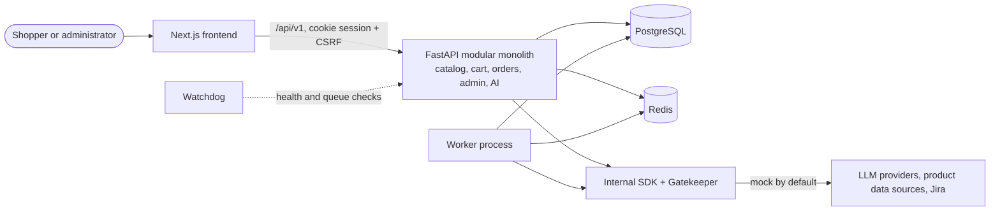

# eShop_AI

A cloud-native, AI-powered electronics e-commerce platform, built as an
educational, non-commercial portfolio project to demonstrate software
engineering, DevOps, infrastructure as code, observability, AWS and agentic AI.

> **Status: M0 — Project Initialization.** Requirements, architecture,
> security baseline, delivery plan and development tooling are documented.
> **No application code exists yet**; every product capability below is
> **planned**. Payments are always simulated and all data is synthetic.

## Objectives

- Build a realistic storefront and back office on a clean, modular architecture.
- Add an AI shopping assistant grounded in live catalog data, with strict
  safety and cost controls.
- Practise production-style DevOps: containers, CI/CD with security scanning,
  Kubernetes, GitOps, observability and cost-aware AWS deployment.
- Document decisions, risks and trade-offs the way a professional team would.

## Planned Capabilities

| Area | Capabilities (planned) |
|---|---|
| Customers | Catalog browsing across eight electronics categories, keyword search with facets, product comparison, cart and wishlist, simulated checkout, order history and tracking |
| Administrators | Product, category and inventory management, order processing, role-based access, audit log, dashboard; CSV/JSON product imports (Advanced) |
| AI shopping assistant | Natural-language product search, budget-aware recommendations, specification explanations and comparisons, always grounded in catalog data through read-only MCP tools |
| DevOps AI assistant (Advanced) | Log, CI failure and alert summaries, incident reports and Jira incident drafts; read-only, and nothing is submitted or remediated without human approval |

## Architecture

A FastAPI **modular monolith** with a Next.js frontend, PostgreSQL and Redis
([ADR-0001](docs/adr/0001-monorepo-and-modular-monolith.md)). AI runs as a
backend module, not a separate service
([ADR-0002](docs/adr/0002-ai-inside-backend.md)).



- **Internal SDK:** every external service is reached through typed,
  mockable interfaces with timeouts, bounded retries and validated responses
  ([ADR-0003](docs/adr/0003-internal-sdk-and-provider-abstraction.md)).
- **Gatekeeper:** one place for inbound rate limits, outbound API quotas and
  AI token budgets, with defined fallbacks.
- **Watchdog:** aggregates dependency health, queue and dead-letter depth;
  it reports, it never remediates on its own.

Details: [Architecture](docs/ARCHITECTURE.md), with 14 diagrams covering
containers, checkout, imports, AI/MCP, CI/CD, GitOps and incidents.

## Technology Stack

| Layer | Technologies |
|---|---|
| Frontend | Next.js, React, TypeScript (strict), Tailwind CSS, shadcn/ui |
| Backend | Python 3.13, uv, FastAPI, Pydantic, SQLAlchemy, Alembic, PostgreSQL, Redis |
| AI | LangGraph, MCP, provider-independent LLM interface, deterministic mock provider |
| Quality | Ruff, mypy, pytest, ESLint, Prettier |
| DevOps | Docker, Docker Compose, GitHub Actions, Gitleaks, Dependabot, pip-audit, npm audit, Trivy |
| Platform | kind, Helm, Argo CD, Terraform |
| Observability | Prometheus, Grafana, OpenTelemetry, structured JSON logs |
| Cloud (deferred) | AWS: IAM, VPC, ECR, RDS, S3, CloudFront, CloudWatch, Secrets Manager; compute platform chosen after a cost review |

Technologies are introduced milestone by milestone, never ahead of need.

## Local First, Cloud When Approved

Everything runs locally at zero cloud cost with demo data and a mock AI
provider ([ADR-0006](docs/adr/0006-local-first-incremental-cloud.md)).
Containers arrive progressively: basic Docker images in M1, Compose services
added through M5, production-hardened images in M7, and a local Kubernetes
cluster (kind) with Helm and Argo CD in M8
([ADR-0008](docs/adr/0008-docker-and-kubernetes-adoption.md)).

AWS staging and demo environments come later and only after a documented
cost estimate and explicit approval. The AWS compute platform (EC2, ECS or
EKS) is deliberately undecided until that review. The same immutable images
are promoted across environments; differences are configuration only.

## Delivery Plan

| Track | Scope | Target |
|---|---|---|
| **Essential** (Tier 1) | Secure storefront and back office, simulated checkout, internal SDK, Gatekeeper, grounded AI assistant, containers, CI with scanning, security review | Portfolio release `v0.1.0-portfolio`, about 8 weeks |
| **Advanced** (Tier 2) | Imports and background jobs, mature CI/CD, Kubernetes and GitOps, observability, cost-approved AWS staging, DevOps AI | Later releases |
| **Optional** (Tier 3) | MFA, session management, price synchronization, circuit breakers, real-provider AI evaluation, advanced commerce features | As time permits |

Milestones M0 to M11, the 123-task backlog and estimates are in the
[Roadmap](docs/ROADMAP.md).

## Repository Structure

```
frontend/         Next.js application (M1)
backend/          FastAPI modular monolith, internal SDK, platform components (M1)
infrastructure/   Terraform (M9)
deployment/       Docker, Kubernetes and Helm (M1, M8)
monitoring/       Dashboards and alert rules as code (M8)
tests/            End-to-end, performance and AI evaluation suites
scripts/          Development tooling — documentation validator (available now)
docs/             PRD, architecture, roadmap, security, development guide, ADRs
.claude/          Claude Code project rules
.vscode/          Shared editor settings and extension recommendations
```

## Getting Started

Prerequisites today: Git and Python 3.11 or newer. The full toolchain
(uv, Node.js LTS, Docker) is needed from M1 — see the
[Development Guide](docs/DEVELOPMENT.md).

Available now:

```bash
python3 scripts/validate_docs.py --strict          # documentation consistency checks
python3 -m unittest discover -s scripts/tests -v   # validator self-tests
git check-ignore -v .env                            # confirms local secrets are ignored
```

## Security and Cost Principles

- Simulated payments only; no real card data is ever collected or stored.
- Cookie-based server-side sessions with CSRF protection, Argon2id password
  hashing and server-side authorization
  ([ADR-0004](docs/adr/0004-cookie-sessions-and-csrf.md)).
- Money as integer cents in USD ([ADR-0005](docs/adr/0005-integer-cents-usd.md)).
- No secrets in the repository; scanning for secrets, dependencies and images.
- AI never receives database credentials or customer personal data; its
  tools are read-only and authorized on the server.
- No cloud resource, paid API or public deployment without explicit approval.

See [Security](docs/SECURITY.md) for the threat model and how to report a
vulnerability privately.

## Documentation

| Document | Purpose |
|---|---|
| [Product Requirements](docs/PRD.md) | Scope, requirements and acceptance criteria |
| [Architecture](docs/ARCHITECTURE.md) | System design and diagrams |
| [Roadmap](docs/ROADMAP.md) | Milestones, delivery tiers, backlog and estimates |
| [Decisions](docs/DECISIONS.md) | Index of Architecture Decision Records |
| [Security](docs/SECURITY.md) | Security baseline, threat model, incident response |
| [Development Guide](docs/DEVELOPMENT.md) | Setup, commands and workflow |
| [Contributing](CONTRIBUTING.md) | Branches, commits, reviews and Definition of Done |

## Contributing

Work follows Jira tasks, short-lived branches and Conventional Commits; every
change is reviewed by the project owner, including AI-assisted work. See
[CONTRIBUTING.md](CONTRIBUTING.md).

## License

No license has been chosen yet; until one is added, all rights are reserved.
