# eShop_AI — System Architecture

| Field | Value |
|---|---|
| Document | System Architecture |
| Version | 0.1 — Draft |
| Status | Approved by the project owner (2026-11-28, M0 exit); changes through pull requests |
| Jira | SHOP-003 |
| Milestone | M0 — Project Initialization |
| Last updated | 2026-11-25 |
| Related | [PRD](PRD.md) v0.3 · [Roadmap](ROADMAP.md) v0.2 · [Decisions](DECISIONS.md) · [Security](SECURITY.md) |

> **Implementation status:** no application code exists yet. This document
> describes the target architecture. Requirements are specified in the
> PRD and are referenced by ID rather than repeated here.

## Status Legend

Every component and decision carries one of these statuses:

| Status | Meaning |
|---|---|
| **Implemented** | Built and verified in the repository. *Nothing is implemented yet.* |
| **Approved** | Decided by the project owner or an accepted ADR; to be implemented as planned. |
| **Proposed** | Recommended design; confirmed or adjusted in the task listed. |
| **Deferred** | Intentionally undecided; resolved by the PRD unresolved decision (UD-nn) and task listed. |

Diagram colours: green = approved, blue = proposed, grey dashed = deferred.

---

## 1. System Overview

eShop_AI is a cloud-native electronics e-commerce application built as a
**non-commercial portfolio project**. All payments are simulated, prices
are USD integer cents and all customer data is synthetic.

| Characteristic | Decision | Status |
|---|---|---|
| Repository | Monorepo: frontend, backend, infrastructure, deployment and docs | Approved ([ADR-0001](adr/0001-monorepo-and-modular-monolith.md)) |
| Backend style | FastAPI modular monolith with explicit module boundaries | Approved ([ADR-0001](adr/0001-monorepo-and-modular-monolith.md)) |
| AI placement | AI as a backend domain module; no separate AI service | Approved ([ADR-0002](adr/0002-ai-inside-backend.md)) |
| External access | Internal SDK with typed, mockable provider interfaces | Approved ([ADR-0003](adr/0003-internal-sdk-and-provider-abstraction.md)) |
| Authentication | Server-side cookie sessions with CSRF protection | Approved ([ADR-0004](adr/0004-cookie-sessions-and-csrf.md)) |
| Money | Integer cents, USD only | Approved ([ADR-0005](adr/0005-integer-cents-usd.md)) |
| Environments | Local-first; incremental, cost-approved AWS adoption | Approved ([ADR-0006](adr/0006-local-first-incremental-cloud.md)) |
| Database | PostgreSQL as the system of record | Approved ([ADR-0007](adr/0007-postgresql-primary-database.md)) |
| Containers | Docker from M1; Kubernetes locally with kind from M8 | Approved ([ADR-0008](adr/0008-docker-and-kubernetes-adoption.md)) |
| AWS platform | ECS, EKS or EC2-based | Deferred (UD-01, SHOP-093) |

**Architectural boundaries:**

1. **Frontend ↔ backend:** HTTP JSON API under `/api/v1`, described by
   OpenAPI. The frontend holds no business rules that the backend does not
   enforce.
2. **Module ↔ module:** modules call each other only through public
   service interfaces; no shared repositories or cross-module ORM access.
3. **Backend ↔ outside world:** every external call goes through
   `backend/app/integrations/` and is governed by Gatekeeper.
4. **Application ↔ AI:** models never touch the database or
   infrastructure; they request data through read-only, authorized tools.
5. **Local ↔ cloud:** identical container images; differences are
   configuration only; cloud resources require explicit approval.

## 2. Architecture Diagrams

### 2.1 System Context

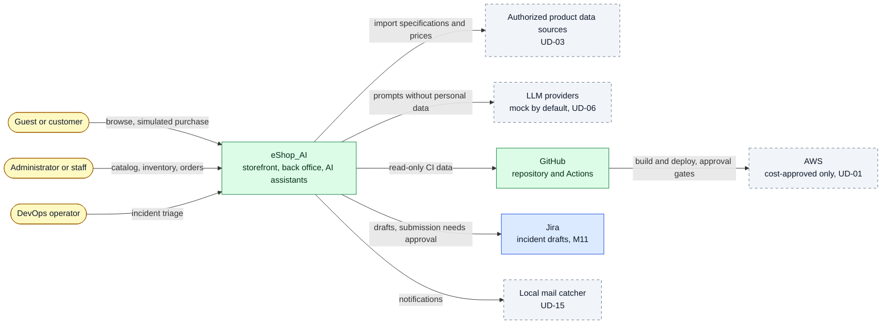

### 2.2 Container Architecture

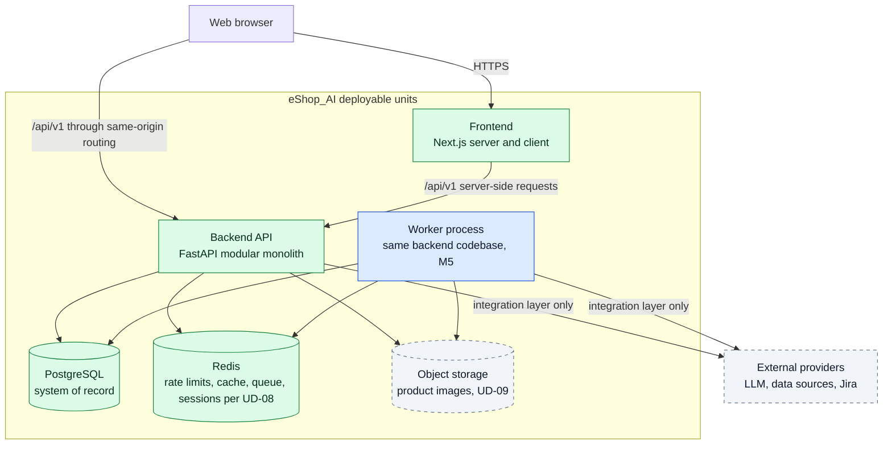

### 2.3 Backend Component Architecture

Package layers (arrows mean *depends on*):

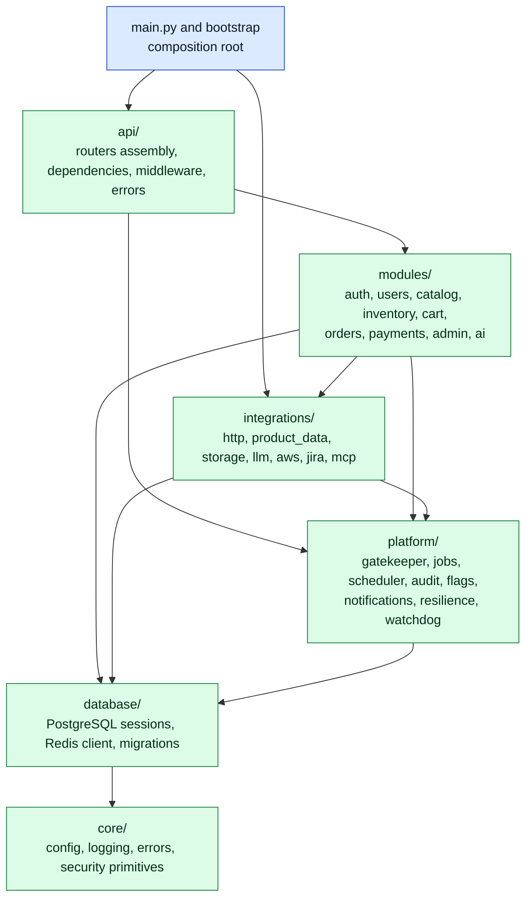

Domain module dependencies (arrows mean *calls the public service of*):

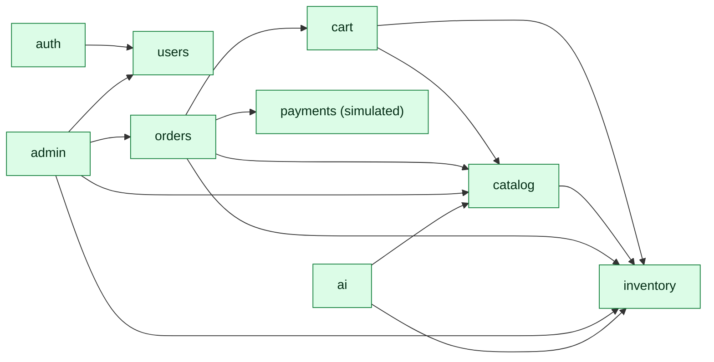

### 2.4 Frontend Architecture

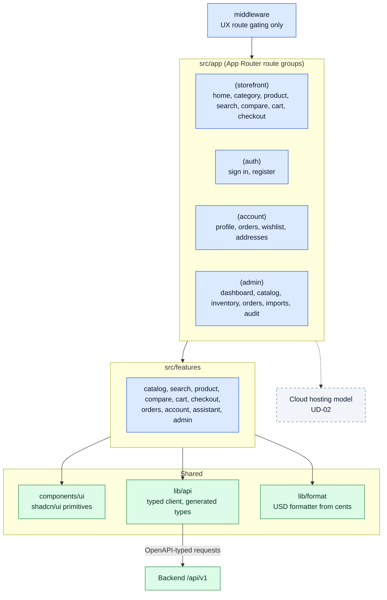

### 2.5 Local Docker Architecture

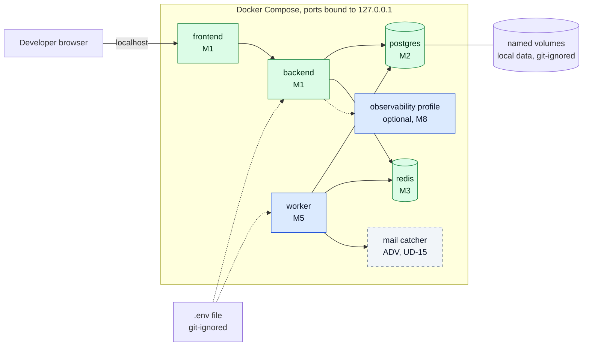

### 2.6 Proposed AWS Architecture (Deferred)

One generic shape covers all options in section 11; the compute layer and
optional services are decided in M9 (UD-01, UD-02, UD-09).

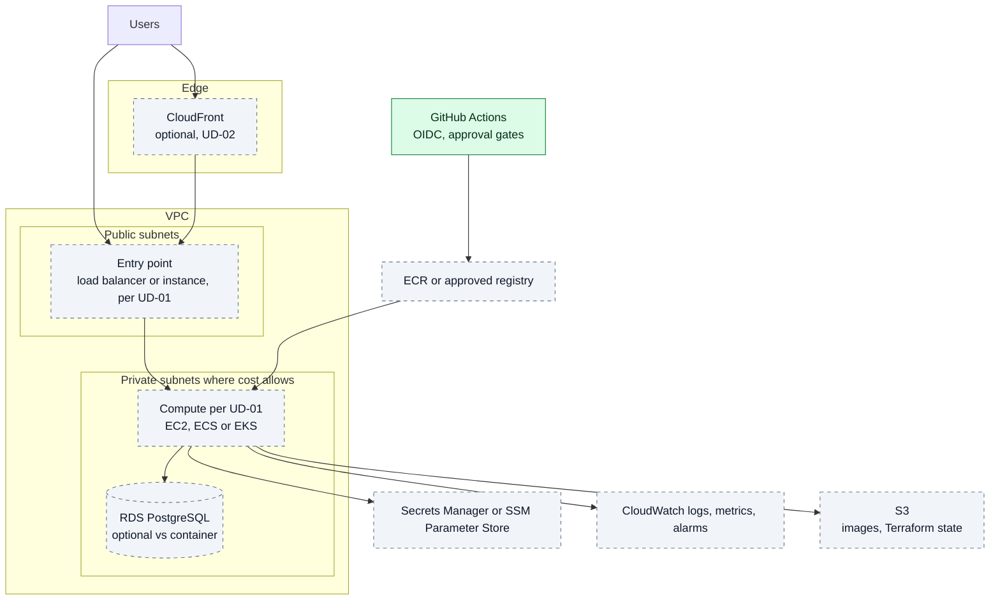

### 2.7 CI/CD Pipeline

```mermaid
flowchart LR
  classDef approved fill:#dcfce7,stroke:#15803d,color:#052e16
  classDef proposed fill:#dbeafe,stroke:#1d4ed8,color:#0f172a
  classDef deferred fill:#f1f5f9,stroke:#64748b,color:#0f172a,stroke-dasharray:5 5

  pr["Pull request"]:::approved --> quality["Lint, format,<br/>type checks"]:::approved
  quality --> tests["Unit and integration<br/>tests"]:::approved
  tests --> scans["Gitleaks, pip-audit,<br/>npm audit, M1"]:::approved
  scans --> build["Build images<br/>M1 basic"]:::approved
  build --> trivy["Trivy scan<br/>blocking from M7"]:::proposed
  trivy --> e2e["E2E on Compose<br/>M7"]:::proposed
  e2e --> review{"Review and<br/>required checks"}:::approved
  review -->|"merge to main"| publish["Publish image<br/>tagged with commit SHA, M7"]:::proposed
  publish --> deploycfg["Update deployment config<br/>M8 kind, M10 cloud"]:::deferred
```

### 2.8 GitOps Deployment Flow

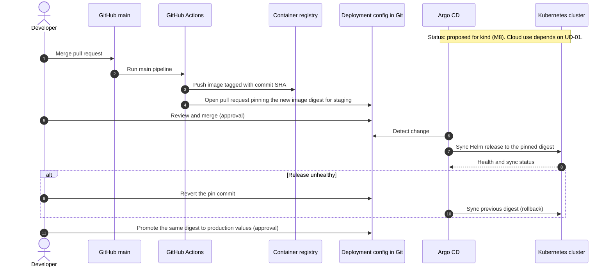

### 2.9 Customer Checkout Sequence

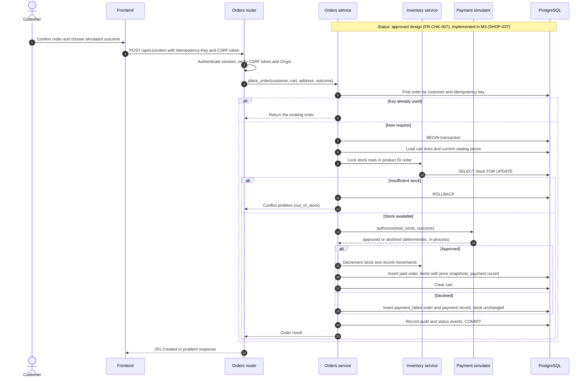

### 2.10 Product Import Sequence

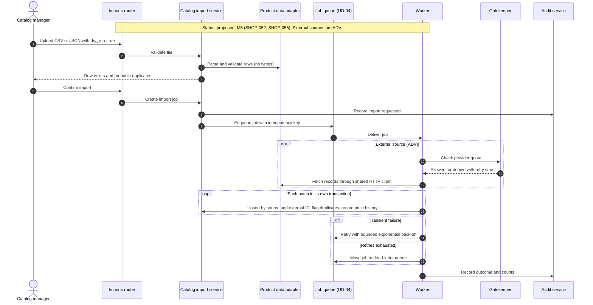

### 2.11 AI Assistant and MCP Sequence

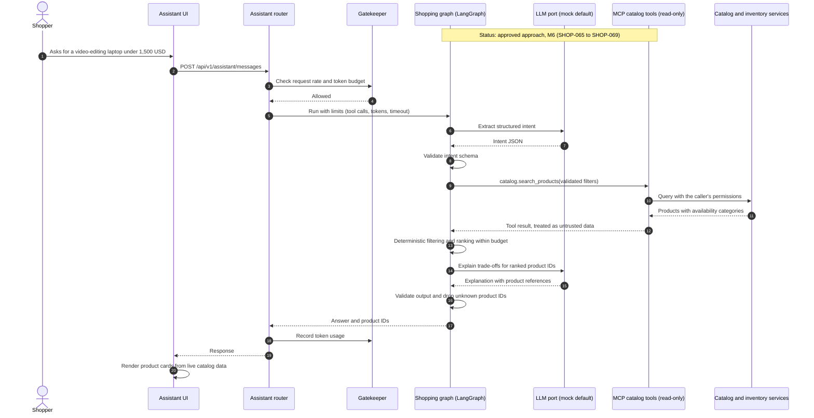

### 2.12 Incident Detection and Notification Flow

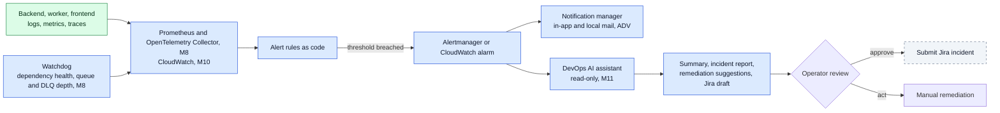

## 3. Backend Architecture

### 3.1 Package Layout

Status: **Approved** layout (SHOP-003). Implemented in SHOP-010:
`main.py`, `__main__.py` (Uvicorn entry point with the graceful-shutdown
timeout), `api/router.py`, `core/settings.py` and the package skeleton.
`bootstrap.py` is added with the first long-lived component (SHOP-012 or
SHOP-023); until then the lifespan in `main.py` holds the settings.

```
backend/
  app/
    main.py            application factory and lifespan
    bootstrap.py       composition root: builds and wires shared components
    worker.py          worker entry point (M5), same codebase
    api/               router assembly (/api/v1), shared dependencies,
                       middleware, exception handlers, OpenAPI settings
    core/              settings, logging, error types, security primitives
    database/          PostgreSQL engine and sessions, Redis client,
                       declarative base, Alembic environment
    modules/
      <module>/        router.py, schemas.py, service.py, repository.py,
                       models.py, errors.py (only the files a module needs)
    integrations/      internal SDK (section 4)
    platform/          platform components (section 5)
  migrations/          Alembic revisions
  tests/               unit/, integration/, api/
```

### 3.2 Dependency Rules

A package may import only from the packages listed for it. The rules form
a directed acyclic graph and are enforced by import-linter
(`uv run lint-imports`, configured in `backend/pyproject.toml`, SHOP-011),
which runs in CI from SHOP-017.

| Package | May depend on |
|---|---|
| core | (none) |
| database | core |
| platform | database, core |
| integrations | platform, database, core |
| modules | integrations, platform, database, core |
| api | modules, platform, database, core |
| bootstrap | api, modules, integrations, platform, database, core |

- `platform` never imports `integrations` or `modules`. Where a platform
  component needs something from them (for example Watchdog health checks
  or notification channels), the composition root registers it through an
  interface (dependency inversion).
- Modules never import `api`. Routers live inside each module and are
  assembled by `api/`.

### 3.3 Domain Modules

| Module | Responsibility | Owns data | Calls modules |
|---|---|---|---|
| auth | Registration, sign-in/out, sessions, CSRF tokens, password policy and hashing | sessions (per UD-08) | users |
| users | Profiles, addresses, roles and role assignment | users, roles, user_roles, addresses | (none) |
| catalog | Categories, brands, attribute schemas, products, specifications, images, search and facets, price history, product imports | categories, brands, products, specs, images, price_history, import_jobs | inventory |
| inventory | Stock levels, movements, availability categories, low-stock thresholds | inventory_items, inventory_movements | (none) |
| cart | Guest and customer carts, wishlist, cart merge, server-side totals | carts, cart_items, wishlist_items | catalog, inventory |
| orders | Checkout use case, order state machine, history, tracking events, cancellation | orders, order_items, order_status_events | cart, catalog, inventory, payments |
| payments | Deterministic payment simulator and payment records | simulated_payments | (none) |
| admin | Back-office use cases composed from other modules; dashboard queries | (none) | catalog, inventory, orders, users |
| ai | Shopping assistant, later DevOps assistant, MCP tool definitions, evaluation hooks | assistant session state | catalog, inventory |

The module call graph (section 2.3) is acyclic. Product imports live in
`catalog` because they write catalog data; import execution uses
`platform` jobs.

### 3.4 API Boundaries

- Each module exposes a **public service interface** (its `service.py`
  functions or classes re-exported from the module package). Everything
  else is private to the module.
- Routers call only their own module's services. Cross-module work is done
  by the calling module's service invoking another module's public service.
- A module's tables are read and written only by that module's
  repositories. Read-heavy cross-module views (for example availability on
  listings) use batched public service calls, not cross-module joins in
  repositories.

### 3.5 Repositories

- Repositories are concrete SQLAlchemy classes per module. Business logic
  depends on them directly; no generic repository base or unit-of-work
  framework is introduced.
- A `Protocol` interface is added only where a fake is genuinely useful
  for unit tests. Integration tests use real PostgreSQL.
- Repositories never commit; transaction control belongs to services
  (section 3.7).

### 3.6 Dependency Injection

- **Composition root:** during application start-up (`lifespan`),
  `bootstrap.py` creates long-lived components: settings, database engine,
  Redis client, shared HTTP client, provider adapters selected by
  configuration and feature flags, and platform components. They are
  stored on the application state and closed on shutdown.
- **Request scope:** FastAPI `Depends` functions provide the database
  session, current user and permissions, CSRF validation and services.
- **Worker:** `worker.py` uses the same bootstrap without FastAPI, so
  business logic is identical in API and worker processes.
- No third-party DI container is used.

### 3.7 Transaction Management

- One asynchronous database session per request or job.
- The service method implementing a use case owns the transaction
  boundary; nested service calls share the same session.
- No network I/O inside a database transaction. The in-process payment
  simulator is the only exception because it performs no I/O.
- Audit events are written in the same transaction as the change they
  describe. Side effects outside the database (notifications, external
  calls) are scheduled as jobs after commit.

### 3.8 Error Handling

Domain errors derive from a common application error type and are mapped
centrally in `api/` to RFC 9457 problem details
(`application/problem+json`).

| Error | HTTP | Notes |
|---|---|---|
| Validation error | 422 | Field-level details in `errors` |
| Not authenticated | 401 | No detail about account existence |
| Forbidden | 403 | Also used for failed CSRF validation |
| Not found | 404 | Also returned for objects the caller may not see |
| Conflict | 409 | Out of stock, invalid state transition, idempotency key reuse with a different payload |
| Rate limited | 429 | `Retry-After` header |
| Dependency unavailable | 503 | Database, Redis or provider outage |
| Unexpected error | 500 | Generic message only; details logged with correlation ID |

Example response:

```json
{
  "type": "https://eshop-ai.local/problems/out-of-stock",
  "title": "Product out of stock",
  "status": 409,
  "detail": "One or more items are no longer available.",
  "code": "out_of_stock",
  "correlation_id": "01JD…",
  "errors": [{ "field": "items[1].product_id", "code": "out_of_stock" }]
}
```

Implemented contract (SHOP-012):

- Responses use `application/problem+json`. `correlation_id` equals the
  `X-Request-ID` response header. An incoming `X-Request-ID` is accepted
  only if it is a single value matching `^[A-Za-z0-9._-]{8,64}$`;
  otherwise a new 32-character hex ID is generated and a warning (without
  the supplied value) is logged.
- Plain HTTP errors (404, 405, ...) use `type: "about:blank"`, the HTTP
  reason phrase as `title` and `detail`, and keep headers such as `Allow`.
  Validation, application and internal errors use
  `https://eshop-ai.local/problems/<code-with-dashes>`. Validation `errors`
  contain only field paths and error codes, never input values.
- Unexpected exceptions are caught by the request middleware, logged at
  ERROR and answered with a generic 500.

Logging: one JSON object per line on stdout with `timestamp` (UTC, ms,
`Z`), `level`, `service`, `logger`, `event`, `correlation_id` (null outside
a request) and any `extra` fields that do not override core fields. The access log (`app.api.access`,
"request completed") records `method`, `route` (matched template or
`<unmatched>`, never the raw path or query), `status_code` and
`duration_ms`. Keys containing password, secret, token, authorization,
cookie, session, csrf, api_key or credential are replaced with
`[REDACTED]` by the formatter. Exceptions are logged as `exc_type` and
`exc_frames` only, never the message. `LOG_LEVEL` and `LOG_FORMAT`
(`json` or `console`) configure it.

## 4. Internal SDK and Integrations

Status: **Approved** ([ADR-0003](adr/0003-internal-sdk-and-provider-abstraction.md)); built in M5
(SHOP-053) with LLM and MCP parts in M6.

### 4.1 Capabilities

| Capability (`integrations/…`) | Interface operations (illustrative) | Adapters | Mock | Official SDK use | Status |
|---|---|---|---|---|---|
| `http` | shared client, request with policy | one client per application | transport stub | HTTP client library | Approved, M5 |
| `product_data` | `fetch_products`, `fetch_prices`, `parse_file` | CSV/JSON files, demo dataset, external sources | fixture-backed | provider SDK where official | CSV/JSON approved; sources deferred (UD-03) |
| `storage` | `put_object`, `get_url`, `delete_object` | local filesystem, S3-compatible | in-memory | AWS SDK for Python for S3 | Deferred (UD-09) |
| `llm` | `generate_structured`, `generate_text`, token accounting | provider adapters | deterministic mock | provider SDKs or framework chat-model integrations (UD-06) | Approved interface; provider deferred |
| `aws` | narrow helpers only when deployed | S3, optional metrics | stubs | AWS SDK for Python | Deferred (M9/M10) |
| `jira` | `create_issue_draft`, `submit_issue` (approval) | Jira REST API via shared client | recorder | REST API unless an official SDK is confirmed | Proposed, M11 |
| `mcp` | tool registry, invoke tool with caller context | in-process tool server | in-process | official MCP Python SDK | Approved, M6; transport deferred (UD-10) |

### 4.2 Cross-Cutting Behaviour

| Concern | Rule |
|---|---|
| Connection lifecycle | Clients are created once in the composition root, reused, and closed on shutdown. No client per call. |
| Timeouts | Every call has explicit connect and read timeouts from configuration (defaults: data sources 10 s, LLM 30 s per NFR-AI-012). |
| Bounded retries | Only transient failures (timeouts, 429, 5xx) on idempotent operations; maximum attempts and total duration; exponential back-off with jitter; honour `Retry-After`. Implemented through the shared retry policy (section 5). |
| Rate limits and quotas | Gatekeeper checks the provider quota before each call and records usage after it. |
| Idempotency | Writes carry idempotency keys (import upserts by source and external ID; Jira drafts keyed by incident ID). |
| Structured errors | Adapters translate provider errors into an integration error taxonomy: `Timeout`, `RateLimited`, `Unavailable`, `AuthenticationFailed`, `NotFound`, `InvalidResponse`, each with a `retryable` flag. Provider exceptions never escape adapters. |
| Response validation | Responses are validated with Pydantic and size-limited; content is untrusted. |
| Telemetry | One span per call; metrics for calls, latency, errors and (for LLMs) tokens; logs contain metadata only. |
| Mocks | Every capability has a deterministic mock selected by configuration; the default for local development and tests. |
| Credentials | Supplied by environment variables or managed secrets; least privilege; never logged. |

**Packaging:** the SDK stays inside the backend. Extracting a shared
package is considered only when at least two independently deployed
services need it (section 13).

### 4.3 Frontend API Client from OpenAPI

**Implemented (SHOP-015, ADR-0010).** Generator: openapi-typescript. Files:
`backend/scripts/export_openapi.py`, `frontend/src/lib/api/openapi.json`,
`schema.d.ts` (generated, committed), `client.ts` (isomorphic core),
`server-client.ts`, `browser-client.ts`, `errors.ts`, `types.ts`. Commands:
`npm run generate:api` and the drift check `npm run check:api` (CI wiring:
SHOP-017).

1. FastAPI generates the OpenAPI document with stable operation IDs.
2. A script exports it to a committed file in the frontend.
3. openapi-typescript (UD-14, ADR-0010) produces TypeScript types.
4. A thin, hand-written client wraps `fetch` using those types and adds
   credentials, the CSRF header and problem-details error normalization.
5. CI regenerates the types and fails on any difference (AC-048).

## 5. Platform Components

All platform components run **in-process** inside the API or worker. None
is a standalone service. Each one prefers an existing framework or
infrastructure capability (FR-PLAT-016).

| Component | Responsibility | Interface (illustrative) | Built on | Status, milestone |
|---|---|---|---|---|
| Gatekeeper | Inbound rate limits, outbound provider quotas, AI token budgets, fallback decisions | `check(policy, key, cost)` returns allow or deny with retry time; `record(policy, key, usage)` | Redis counters; rate-limiting library for HTTP middleware | Approved, inbound limits M3, consolidated M5 |
| Watchdog | Aggregates dependency health, queue and DLQ depth, schedule lag; exposes status and metrics | `register_check(name, check, critical)`; `status()` | Readiness endpoint, Prometheus metrics, Kubernetes probes, Alertmanager | Proposed, basic health M1, full M8 |
| Background workers | Execute asynchronous jobs with persisted state | `enqueue(job_type, payload, idempotency_key)`; handler registry | Job framework (UD-04) | Approved concept, M5 |
| Scheduler | Declarative schedules with single execution | schedule list in configuration; enable flag per schedule | Job framework scheduler or Kubernetes CronJob | Deferred tool (UD-04), M5 |
| Notification manager | Channel-independent notifications with templates and delivery status | `notify(recipient, template, data, channels)`; channel interface | In-app store plus local mail catcher (UD-15) | Proposed, ADV M5 |
| Audit logging | Append-only record of back-office writes, security events and AI approvals | `record(actor, action, target, changes, context)`; `query(filters, cursor)` | PostgreSQL table, same transaction as the change | Approved, M4 |
| Feature flags | Typed, safe-by-default switches; public subset for the frontend | `is_enabled(flag)`; `public_flags()` (`context` added with targeting) | Typed `FEATURE_*` settings; `GET /api/v1/config/public-flags` (ADR-0009) | Implemented (SHOP-016, ADR-0009) |
| Retry management | Shared bounded retry policies | policy: attempts, total duration, back-off, retryable errors | Job framework retries or a retry library | Approved, M5 |
| Dead-letter handling | Hold exhausted jobs; inspect, retry or discard with audit | `list()`, `retry(id)`, `discard(id)` | Job framework failure handling plus a table if required | Approved, M5 |
| Circuit breakers | Stop calling failing providers temporarily | per-provider state: closed, open, half-open | Library, only when justified | Proposed, ADV M5 |

**Three distinct control planes:**

| Concern | Purpose | Mechanisms | Owner |
|---|---|---|---|
| Application-level protection | Protect the application from abuse and invalid use | Input validation, authorization, CSRF, Gatekeeper inbound rate limits, idempotency | API and modules |
| Infrastructure monitoring | Detect failures and degradation | Health and readiness checks, Watchdog, metrics, traces, logs, alerts | Platform and DevOps |
| AI usage controls | Bound AI cost and behaviour | Gatekeeper token budgets, per-request limits (NFR-AI-010 to 017), tool allow-lists, feature flags, mock-by-default | AI module and Gatekeeper |

## 6. Frontend Architecture

Status: stack **Approved**; structure **Confirmed** in SHOP-014. Implemented
now: `app/(storefront)` with the home page, `components/ui` (shadcn/ui),
`components/layout` (header, footer, skip link, theme toggle, mobile
navigation) and the root `not-found`, `error` and `loading` states. The
other route groups, `features/`, `lib/api`, `lib/format` and `middleware.ts`
are planned and added by later tasks.

### 6.1 Structure

```
frontend/src/
  app/
    (storefront)/  (auth)/  (account)/  (admin)/
  features/<feature>/   components/, hooks/, api.ts, schemas.ts
  components/ui/        shadcn/ui primitives
  components/layout/    header, footer, navigation, admin shell
  lib/api/              generated types and typed client
  lib/format/           money (cents to en-US USD), dates
  middleware.ts         redirect-only route gating
```

### 6.2 Route Groups

| Group | Routes (illustrative) | Access |
|---|---|---|
| `(storefront)` | `/`, `/c/[...category]`, `/p/[slug]`, `/search`, `/compare`, `/cart`, `/checkout` | Public (checkout requires sign-in) |
| `(auth)` | `/sign-in`, `/register`, `/forgot-password` (ADV) | Public |
| `(account)` | `/account`, `/account/orders`, `/account/orders/[orderNumber]`, `/account/wishlist`, `/account/addresses` | Customer |
| `(admin)` | `/admin`, `/admin/products`, `/admin/categories`, `/admin/inventory`, `/admin/orders`, `/admin/customers`, `/admin/imports`, `/admin/jobs`, `/admin/audit` | Back-office roles |

The AI assistant is a feature component available on storefront pages, not
a separate route group.

### 6.3 Components and Features

- Feature folders own their components, hooks and API calls; shared UI
  lives in `components/ui` (shadcn/ui on accessible primitives).
- Pages compose features; features never import other features' internals.

### 6.4 Server versus Client Components and State

| Concern | Approach |
|---|---|
| Default rendering | Server components for pages and data loading |
| Client components | Only for interactivity: filters, cart controls, forms, assistant chat, admin tables |
| Server state | Fetched on the server for pages; mutations through the typed client, followed by route refresh. A client data-cache library is added only by ADR if needed. |
| URL state | Filters, sorting, pagination and comparison selections live in the URL (FR-SRCH-007, FR-CMP-003) |
| Local UI state | React state; no global store initially |
| Cart | The backend is the source of truth |

### 6.5 API Client and Same-Origin Access

- The browser calls `/api/v1/*` on the **same origin** as the frontend.
  **Implemented (SHOP-015):** a Next.js route handler
  (`frontend/src/app/api/v1/[...path]/route.ts`) forwards `/api/v1/*` to
  `BACKEND_INTERNAL_URL`, read at request time (not `rewrites`, which are
  fixed at build time in standalone output). It uses header allow-lists in
  both directions, rejects empty, `.` and `..` segments and answers 502
  `application/problem+json` when the backend is unreachable. `/health/*` is
  not exposed. In the cloud, the entry point routes by path (UD-02). This
  avoids cross-site cookies and broad CORS rules.
- Server components call the backend's internal URL and forward the
  incoming session cookie only for authenticated pages; public catalog
  pages are fetched without credentials so they can be cached. Cookie
  forwarding for server calls is deferred to authentication (SHOP-032);
  today's server client calls public endpoints only.
- The client attaches the CSRF token header to every state-changing
  request and normalizes problem-details errors.

### 6.6 Loading and Error States

- Each route segment defines `loading`, `error` and `not-found` states;
  skeletons for listings and product pages.
- Empty states for search, cart, wishlist and orders (NFR-USE-003).
- Error messages are user-friendly and include no internal details.

### 6.7 Accessibility and Responsive Design

- WCAG 2.2 AA target; keyboard operability and visible focus; semantic
  landmarks; labelled form controls; automated accessibility checks.
- Mobile-first Tailwind breakpoints from 360 px to 1920 px.
- English-only UI; money always formatted from integer cents by one
  shared USD formatter.

### 6.8 Hosting

The cloud hosting model (Next.js server in a container, static export
with CloudFront, or hybrid) is **Deferred** (UD-02, SHOP-093).

## 7. Database Architecture

Status: PostgreSQL **Approved**
([ADR-0007](adr/0007-postgresql-primary-database.md)); the schema below is
**Proposed** and finalized in SHOP-023 and SHOP-024.

### 7.1 Conceptual Entity Relationship Diagram

```mermaid
erDiagram
  USERS ||--o{ USER_ROLES : has
  ROLES ||--o{ USER_ROLES : grants
  USERS ||--o{ SESSIONS : owns
  USERS ||--o{ ADDRESSES : has
  CATEGORIES ||--o{ CATEGORIES : parent_of
  CATEGORIES ||--o{ CATEGORY_ATTRIBUTES : defines
  CATEGORIES ||--o{ PRODUCTS : contains
  BRANDS ||--o{ PRODUCTS : makes
  PRODUCTS ||--o{ PRODUCT_SPECS : has
  CATEGORY_ATTRIBUTES ||--o{ PRODUCT_SPECS : types
  PRODUCTS ||--o{ PRODUCT_IMAGES : shows
  PRODUCTS ||--|| INVENTORY_ITEMS : stocked_as
  PRODUCTS ||--o{ INVENTORY_MOVEMENTS : moves
  USERS ||--o| CARTS : owns
  CARTS ||--o{ CART_ITEMS : contains
  PRODUCTS ||--o{ CART_ITEMS : added_as
  USERS ||--o{ ORDERS : places
  ORDERS ||--|{ ORDER_ITEMS : contains
  PRODUCTS ||--o{ ORDER_ITEMS : snapshot_of
  ORDERS ||--o{ ORDER_STATUS_EVENTS : tracks
  ORDERS ||--o{ SIMULATED_PAYMENTS : attempts
  PRODUCTS ||--o{ PRICE_HISTORY : priced
  USERS ||--o{ IMPORT_JOBS : requests
  IMPORT_JOBS ||--o{ IMPORT_JOB_ERRORS : reports
  USERS ||--o{ AUDIT_EVENTS : performs

  USERS {
    bigint id PK
    text email UK "unique on lower(email)"
    text password_hash "Argon2id"
    text display_name
    text status
    timestamptz created_at
  }
  ROLES {
    smallint id PK
    text name UK
  }
  USER_ROLES {
    bigint user_id FK
    smallint role_id FK
  }
  SESSIONS {
    text id_hash PK "only if PostgreSQL store, UD-08"
    bigint user_id FK
    text csrf_token_hash
    timestamptz expires_at
    timestamptz last_seen_at
  }
  ADDRESSES {
    bigint id PK
    bigint user_id FK
    text line1
    text city
    text postal_code
    text country_code
  }
  BRANDS {
    bigint id PK
    text slug UK
    text name
  }
  CATEGORIES {
    bigint id PK
    bigint parent_id FK
    text slug
    text name
    int sort_order
  }
  CATEGORY_ATTRIBUTES {
    bigint id PK
    bigint category_id FK
    text key
    text data_type
    text unit
    boolean filterable
    boolean comparable
  }
  PRODUCTS {
    bigint id PK
    text sku UK
    text slug UK
    bigint category_id FK
    bigint brand_id FK
    text name
    text mpn
    text gtin
    int price_cents
    int list_price_cents
    text status
    text source
    text external_id
    timestamptz last_synced_at
  }
  PRODUCT_SPECS {
    bigint product_id FK
    bigint attribute_id FK
    numeric value_numeric
    text value_text
    boolean value_bool
  }
  PRODUCT_IMAGES {
    bigint id PK
    bigint product_id FK
    text storage_key
    text source_url
    text license
    text attribution
    int position
  }
  INVENTORY_ITEMS {
    bigint product_id PK "also FK to PRODUCTS"
    int on_hand "CHECK on_hand >= 0"
    int low_stock_threshold
    timestamptz updated_at
  }
  INVENTORY_MOVEMENTS {
    bigint id PK
    bigint product_id FK
    int delta
    text reason
    bigint order_id FK
    bigint actor_id FK
    timestamptz created_at
  }
  CARTS {
    bigint id PK
    bigint user_id FK "null for guest carts"
    text guest_token_hash UK
    timestamptz updated_at
  }
  CART_ITEMS {
    bigint cart_id FK
    bigint product_id FK
    int quantity
    int price_cents_when_added
  }
  ORDERS {
    bigint id PK
    text order_number UK "random, non-sequential"
    bigint user_id FK
    text status
    int subtotal_cents
    int shipping_cents
    int total_cents
    jsonb shipping_address "snapshot"
    text idempotency_key
    text request_hash
    timestamptz created_at
  }
  ORDER_ITEMS {
    bigint id PK
    bigint order_id FK
    bigint product_id FK
    text sku "snapshot"
    text product_name "snapshot"
    int unit_price_cents "snapshot"
    int quantity
    int line_total_cents
  }
  ORDER_STATUS_EVENTS {
    bigint id PK
    bigint order_id FK
    text status
    text note
    timestamptz occurred_at
  }
  SIMULATED_PAYMENTS {
    bigint id PK
    bigint order_id FK
    text outcome
    int amount_cents
    text simulator_reference
    timestamptz created_at
  }
  PRICE_HISTORY {
    bigint id PK
    bigint product_id FK
    int old_price_cents
    int new_price_cents
    text source
    timestamptz changed_at
  }
  IMPORT_JOBS {
    bigint id PK
    bigint requested_by FK
    bigint retry_of FK
    text source
    text status
    int created_count
    int updated_count
    int skipped_count
    int failed_count
    timestamptz created_at
  }
  IMPORT_JOB_ERRORS {
    bigint id PK
    bigint job_id FK
    int row_number
    text reason
  }
  AUDIT_EVENTS {
    bigint id PK
    bigint actor_id FK
    text action
    text target_type
    text target_id
    jsonb changes "redacted"
    text correlation_id
    timestamptz occurred_at
  }
```

Wishlist items, demo reviews, platform job tables and notifications follow
the same conventions and are omitted for readability.

### 7.2 Principal Entities

| Entity | Purpose |
|---|---|
| Users, roles, user roles | Identity and RBAC; a user may hold several roles |
| Sessions | Server-side session records if PostgreSQL is chosen as the session store (UD-08); otherwise held in Redis with the same fields |
| Categories, category attributes | Category tree and the per-category specification schema that drives validation, facets and comparison |
| Brands, products | Sellable items with status, prices in cents and source metadata (source, external ID, last synchronization) |
| Product specifications | Typed attribute values (numeric, text or boolean) per product, enabling facets |
| Product images | Image references with storage key, source URL, license and attribution |
| Inventory items, movements | Current stock per product and an append-only movement ledger |
| Carts, cart items | Guest or customer cart; prices are recalculated from the catalog, the added price is kept only for change notices |
| Orders, order items, status events | Purchase records with price and address snapshots and a tracking timeline |
| Simulated payments | Outcome of each simulated payment attempt; no card data |
| Price history | Every price change with source and time |
| Import jobs, job errors | Import runs, counts, retry linkage and per-row errors |
| Audit events | Append-only record of who changed what, when |

### 7.3 Keys and Constraints

| Rule | Detail |
|---|---|
| Primary keys | `bigint` identity columns (Proposed). Public references use slugs (products, categories) or random order numbers, never sequential IDs in customer URLs. |
| Foreign keys | Declared for every relationship with `ON DELETE RESTRICT`; products and categories are archived, not deleted. |
| Unique constraints | `lower(email)`; `products.sku`; `products.slug`; `(categories.parent_id, slug)`; `(category_attributes.category_id, key)`; `(products.source, external_id)`; `gtin` where present; `(brand_id, mpn)` where present; `(cart_items.cart_id, product_id)`; `(orders.user_id, idempotency_key)`; `orders.order_number`; `(user_roles.user_id, role_id)` as composite primary key. |
| Check constraints | All `*_cents` columns `>= 0`; `on_hand >= 0`; `quantity > 0`; `line_total_cents = unit_price_cents * quantity`; status columns restricted to their state sets. |
| Money | Integer `*_cents` columns only; no currency column because USD is the only currency ([ADR-0005](adr/0005-integer-cents-usd.md)). `integer` holds item prices; aggregates use `bigint`. |

### 7.4 Indexing Strategy

| Access pattern | Index |
|---|---|
| Category listings | `products (category_id, status)`, plus `price_cents` for range filters and sorting |
| Keyword search | Full-text and trigram indexes on product text (exact design per UD-07, SHOP-021) |
| Facets | `product_specs (attribute_id, value_numeric)` and `(attribute_id, value_text)` |
| Customer orders | `orders (user_id, created_at DESC)` |
| Admin order queues | `orders (status, created_at)` |
| Price history | `price_history (product_id, changed_at DESC)` |
| Audit search | `audit_events (occurred_at)`, `(actor_id, occurred_at)`, `(target_type, target_id)` |
| Import history | `import_jobs (status, created_at)` |
| Foreign keys | Every foreign key column is indexed |

Indexes are added for measured query patterns; each migration that adds
one states the query it serves.

### 7.5 Inventory Consistency and Transactional Boundaries

The initial checkout uses **no stock reservation** (FR-CHK-004 is
optional). Overselling is prevented by a single transaction (FR-CHK-007,
NFR-REL-001):

1. Lock the cart's inventory rows with `SELECT … FOR UPDATE`, in
   ascending product ID order to avoid deadlocks.
2. Verify `on_hand >= quantity` for each line; otherwise roll back and
   return `409 out_of_stock`.
3. Run the in-process payment simulator.
4. On approval, decrement stock, insert movements, the order, order items
   and the payment record; on decline, insert the `payment_failed` order
   and payment record without changing stock.
5. Write the audit and status events, then commit.

The `CHECK (on_hand >= 0)` constraint is a final safeguard. A conditional
`UPDATE … WHERE on_hand >= :quantity` is an acceptable alternative to
explicit row locks; the choice is confirmed in SHOP-037.

| Use case | Transaction scope | Concurrency control |
|---|---|---|
| Place order | Stock check and decrement, order, items, payment, audit | Row locks or conditional update; idempotency key unique constraint |
| Cancel order before shipment | Status change, restock movement, audit | Row lock on the order |
| Admin stock adjustment | Inventory update, movement, audit | Row lock on the inventory item |
| Admin product update | Product, specifications, price history, audit | Optimistic concurrency on an update timestamp |
| Import batch | One batch of upserts with price history | Unique source and external ID; idempotent upserts |
| Cart merge on sign-in | Cart lines merge | Unique cart and product pair |

### 7.6 Historical Purchase Prices

Order items copy `sku`, `product_name` and `unit_price_cents` at purchase
time, and orders copy the shipping address. Later catalog changes never
alter past orders. Price changes are also recorded in `price_history`.

### 7.7 Payment Data

`simulated_payments` stores only the outcome, amount, simulator reference
and timestamp. The schema has no column that could hold card numbers,
CVV or bank details (FR-PAY-003).

## 8. API Architecture

Status: **Proposed** conventions, confirmed in SHOP-010 and SHOP-026.

| Topic | Convention |
|---|---|
| Versioning | URL prefix `/api/v1`. Additive changes stay in v1; breaking changes require `/api/v2` and a deprecation notice. Health endpoints are unversioned. |
| Resources | Plural nouns, kebab-case paths, snake_case JSON fields (matching generated types). State transitions are action sub-resources, for example `POST /orders/{order_number}/cancel`. |
| Pagination | Page-based (`page`, `page_size`, max 100) for catalog listings that need totals and facet counts; cursor-based for audit events and job history. Responses: `items`, pagination metadata, and `facets` where relevant. |
| Filtering | Allow-listed query parameters, for example `brand`, `price_min_cents`, `price_max_cents`, `availability`, `rating_min`, and attribute filters such as `attr.ram_gb.min=16`. Unknown parameters return 422. |
| Sorting | `sort` from an allow-list: `relevance`, `price_asc`, `price_desc`, `newest`, `rating`. |
| Validation | Pydantic models for every request and response; request bodies reject unknown fields. |
| Errors | RFC 9457 problem details (section 3.8). |
| Authentication | Server-side session cookie: `HttpOnly`, `Secure` outside local HTTP, `SameSite=Lax`, `__Host-` prefix in TLS environments ([ADR-0004](adr/0004-cookie-sessions-and-csrf.md)). |
| Authorization | Role and object-level checks on every endpoint; customer endpoints use `/me` paths, not user IDs. |
| CSRF | Synchronizer token bound to the session, fetched from `GET /api/v1/auth/csrf`, sent in `X-CSRF-Token` on unsafe methods; `Origin` verified. Implemented now (SHOP-019): `Origin` verification of unsafe requests; planned (SHOP-032): the token. |
| CORS | Explicit allow-list from `ALLOWED_ORIGINS` (never `*`), credentials allowed; the same-origin proxy is the primary path. Implemented (SHOP-019). |
| Rate limiting | Gatekeeper middleware; `429` with `Retry-After`. |
| Idempotency | `Idempotency-Key` header required on `POST /api/v1/orders`; same key and payload returns the original order; same key with a different payload returns 409. |
| OpenAPI | Served at `/api/v1/openapi.json`; interactive docs enabled locally and protected or disabled in shared environments. |

**Representative endpoint groups** (only Health, SHOP-013, and Config, SHOP-016, are implemented; the rest is planned):

| Group | Base path | Examples | Access |
|---|---|---|---|
| Health (implemented, SHOP-013) | `/health` | `GET /health/live` (always `200 {"status":"ok"}`), `GET /health/ready` (`200 {"status":"ready"}` after start-up, `503 {"status":"not_ready"}` before start-up and once shutdown begins; database and Redis checks arrive in M2, Watchdog checks in M8) | Public |
| Config (implemented, SHOP-016) | `/api/v1/config` | `GET /config/public-flags` (`200 {"ai_assistant": false}`; allow-listed flags only, `Cache-Control: no-store`) | Public |
| Auth | `/api/v1/auth` | `POST /register`, `POST /sign-in`, `POST /sign-out`, `GET /csrf` | Public or session |
| Profile | `/api/v1/me` | `GET /me`, `PATCH /me`, `GET/POST /me/addresses` | Customer |
| Catalog | `/api/v1/categories`, `/api/v1/products` | `GET /categories`, `GET /products?…`, `GET /products/{slug}`, `GET /products/compare?slugs=…` | Public |
| Search | `/api/v1/search` | `GET /search?q=…` | Public |
| Cart and wishlist | `/api/v1/cart`, `/api/v1/me/wishlist` | `GET /cart`, `PUT /cart/items/{product_id}`, `DELETE /cart/items/{product_id}` | Guest or customer |
| Orders | `/api/v1/orders` | `POST /orders`, `GET /orders`, `GET /orders/{order_number}`, `POST /orders/{order_number}/cancel` | Customer |
| Assistant | `/api/v1/assistant` | `POST /assistant/messages` | Guest or customer, rate limited |
| Admin | `/api/v1/admin` | `/products`, `/categories`, `/inventory/{product_id}/adjustments`, `/orders/{id}/transitions`, `/customers`, `/imports`, `/jobs`, `/dead-letters`, `/audit-events`, `/dashboard` | Back-office roles |
| Operations (ADV) | `/api/v1/ops` | `POST /ops/assistant/messages`, `GET /ops/incidents/{id}/draft` | DevOps operator |

## 9. AI and MCP Architecture

Status: **Approved** approach ([ADR-0002](adr/0002-ai-inside-backend.md)); provider and
transport choices **Deferred** (UD-06, UD-10, SHOP-064).

### 9.1 Components

| Component | Location | Role |
|---|---|---|
| LLM port | `integrations/llm/` | Provider-independent operations: structured generation against a schema, text generation, token accounting. Implementations: deterministic mock (default) and provider adapters. |
| Shopping graph | `modules/ai/` | LangGraph workflow for multi-step requests: intent extraction → tool calls → deterministic ranking → explanation → output validation. |
| Simple flows | `modules/ai/` | Single-step tasks (for example explaining a specification) call the LLM port directly; a graph is used only where multiple steps justify it. |
| MCP tools | `modules/ai/` definitions, `integrations/mcp/` server | Read-only catalog and availability tools (PRD section 10.3), invoked in-process with the caller's permissions. |
| Evaluation | `tests/ai/` | Evaluation and prompt-injection suites (AC-040 to AC-045). |

### 9.2 Grounding and Recommendations

- The model extracts a **structured intent** (category, budget in cents,
  required attributes, preferences) that is validated against the category
  attribute schema.
- **Deterministic code** filters and ranks catalog results; the model only
  explains the ranked results.
- Every product reference in the output must exist and be active; unknown
  references are dropped. Prices and availability are rendered from the
  database, never from model text (FR-AI-004, FR-AI-005).
- Natural-language search falls back to keyword search when AI is
  disabled or unavailable (FR-AI-002).

### 9.3 Budgets and Limits

| Limit | Enforced by | Default |
|---|---|---|
| Message length | Request validation | 2,000 characters (NFR-AI-010) |
| Tool calls per turn | Graph runtime | 5 (NFR-AI-011) |
| Request timeout | LLM port | 30 seconds (NFR-AI-012) |
| Output tokens | LLM port | 800 (NFR-AI-013) |
| Requests per session per hour | Gatekeeper | 30 (NFR-AI-014) |
| Daily token budget | Gatekeeper | Owner-defined (UD-06) |

All limits are configurable and validated at start-up (NFR-AI-017).

### 9.4 Prompt Injection Defences and Output Validation

- System instructions are fixed on the server; user, product, review,
  log and tool content is passed as clearly delimited **data**.
- Each assistant has a tool **allow-list**; tool arguments are validated
  against schemas; tools are read-only and authorized independently of the
  model.
- Tool outputs are length-limited and stripped of control characters.
- Every structured output is validated with Pydantic; invalid output is
  retried once, then rejected with a non-AI fallback.
- Prompt-injection test cases cover direct and indirect (product data)
  attacks (AC-043).

### 9.5 Customer Assistant versus DevOps Assistant

| Aspect | Customer shopping assistant | DevOps assistant (M11, ADV) |
|---|---|---|
| Users | Guests and customers | DevOps operators only |
| Data | Public catalog and availability categories | Redacted logs, CI results, alerts |
| Tools | `catalog.*`, `inventory.get_availability` | `ops.*` read-only tools (PRD section 10.3) |
| Outputs | Recommendations and explanations | Summaries, incident reports, remediation suggestions, Jira drafts |
| Actions | None | None without explicit human approval; never executes remediation |
| Budgets | Per-session and global token budgets | Separate operator budget |

Neither assistant receives database credentials, raw SQL access, shell
access, or unrestricted infrastructure tools (Kubernetes, AWS or GitHub
write access). Both reach data only through backend services.

### 9.6 Evaluation

- The mock provider makes CI evaluation deterministic; it verifies the
  pipeline (validation, grounding, tool authorization, fallbacks), not
  model quality.
- Real-provider evaluation runs manually and only with approved budgets
  (SHOP-074).

## 10. DevOps Architecture

### 10.1 Progressive Introduction

| Capability | Introduced | Matured | Status |
|---|---|---|---|
| Docker | Basic Dockerfiles, M1 (SHOP-122, implemented) | Production-optimized images, M7 (SHOP-075) | Approved |
| Docker Compose | Backend and frontend, M1 (SHOP-122, implemented); PostgreSQL M2; Redis M3; worker M5 | Profiles and full-stack verification, M7 (SHOP-076) | Approved |
| GitHub Actions | Lint, type checks, tests, M1 | E2E, gates, publishing, M7; Terraform checks, M9; promotion, M10 | Approved |
| Automated testing | Unit M1; integration M2; E2E local M3 | E2E in CI, coverage gate, performance baseline, M7 | Approved |
| Security scanning | Gitleaks, Dependabot, pip-audit, npm audit, M1 | Trivy images and IaC, blocking thresholds, SBOM, M7 | Approved |
| Container registry | Local images | CI-published images, M7 (registry by ADR); ECR or alternative, M9 | Proposed |
| Terraform | Offline `fmt`/`validate`, M9 | Approved foundation, M9; environments, M10 | Approved tool; resources need approval |
| Kubernetes | kind, M8 | Cloud only if UD-01 selects Kubernetes | Approved (local) |
| Helm | Charts, M8 | Per-environment values, M10 | Approved |
| Argo CD | kind, M8 | Cloud only if Kubernetes-based | Approved (local) |
| Monitoring and alerts | Health checks, M1 | Prometheus, Grafana, Alertmanager, M8; CloudWatch, M10 | Proposed |
| Logging | Structured JSON with correlation IDs, M1 | Aggregation, M8; CloudWatch Logs, M10 | Approved |
| Tracing | — | OpenTelemetry, M8 | Proposed |
| Rollback | Revert-based, M7 | Rehearsed Argo CD or Helm rollback, M8; cloud runbooks, M10 | Proposed |

### 10.2 Environments

| Environment | Purpose | Platform | Status |
|---|---|---|---|
| Development | Daily work, demo data, mock AI | Local machine: native processes or Docker Compose | Approved |
| CI | Automated validation | GitHub-hosted runners with service containers | Approved |
| Local Kubernetes | Helm, GitOps and observability practice | kind | Approved (M8) |
| Staging | Pre-production verification, ephemeral | AWS per UD-01 | Deferred, approval required |
| Production (demo) | Public portfolio demo during demo windows | AWS per UD-01 | Deferred, approval required |

### 10.3 Immutable Image Promotion

1. CI builds each image **once** from `main` and tags it with the commit
   SHA (plus a version tag for releases).
2. The image is scanned and pushed to the registry; deployments reference
   it by **digest**.
3. Staging deploys the digest; after verification, production values are
   updated to the **same digest** through a reviewed change.
4. Environment differences come only from configuration and secrets.
   Images are never rebuilt per environment.
5. Rollback re-deploys the previous digest (Git revert in GitOps).

## 11. AWS Architecture

Status: **Deferred.** No AWS architecture is selected; nothing is
provisioned without an approved cost estimate
([ADR-0006](adr/0006-local-first-incremental-cloud.md), CLAUDE.md section 12). The decision is made in
SHOP-093 (UD-01, UD-02, UD-05, UD-09).

### 11.1 Deployment Alternatives

| Option | Description | Strengths | Weaknesses | Indicative fixed cost (provisional) |
|---|---|---|---|---|
| A. EC2-based | One small instance running the containers (Docker Compose or single-node k3s) | Lowest cost and complexity; easy teardown | Single point of failure; manual patching; less "managed" experience | One small instance plus storage; no control-plane or NAT charge if designed carefully |
| B. ECS | Managed container orchestration (Fargate or EC2 capacity) | Managed scheduling, IAM per task, good AWS learning value | Load balancer and networking costs; no Argo CD | Fargate per vCPU-hour and GB-hour; load balancer hourly charge |
| C. EKS | Managed Kubernetes | Reuses Helm and Argo CD; strongest Kubernetes showcase | Highest cost and complexity | Control plane ≈ $0.10/hour (≈ $73/month) plus nodes and networking |
| D. Hybrid | Kubernetes, Helm and Argo CD demonstrated on local kind; AWS runs option A or B | Shows both skill sets at low cost | GitOps shown locally only | As option A or B |

All prices are **provisional and unverified**, given for us-east-1 at the
time of writing. They must be verified with the AWS Pricing Calculator in
SHOP-093. Other fixed costs to evaluate include NAT gateways
(≈ $0.045/hour plus data processing), public IPv4 addresses
(≈ $0.005/hour each) and Secrets Manager (≈ $0.40 per secret per month).

### 11.2 Service Applicability

| Service | Potential use | Classification |
|---|---|---|
| IAM | Least-privilege roles, GitHub OIDC | Required for any AWS deployment |
| VPC | Network isolation and security groups | Required (default or custom VPC) |
| Compute (EC2, ECS or EKS) | Run containers | Required; option per UD-01 |
| ECR | Image registry | Optional (an approved free registry may suffice) |
| CloudWatch | Logs, metrics, alarms | Required at a basic level; retention limited for cost |
| RDS for PostgreSQL | Managed database with backups | Optional; alternative is PostgreSQL in a container with scheduled backups |
| S3 | Product images, Terraform state, backups | Optional; likely for Terraform state |
| CloudFront | CDN and TLS for the frontend | Optional; depends on UD-02 |
| Secrets Manager or SSM Parameter Store | Managed secrets | Required in some form; service chosen by cost |
| ElastiCache | Managed Redis | Optional; Redis may run in a container |

## 12. Security and Reliability

The complete threat model is maintained in [SECURITY.md](SECURITY.md)
(SHOP-004). This section records the architectural controls.

### 12.1 Trust Boundaries

| ID | Boundary | Main controls |
|---|---|---|
| TB-1 | Internet ↔ frontend | TLS (cloud), security headers, CSP, rate limits |
| TB-2 | Frontend ↔ backend API | Session cookie, CSRF, server-side authorization, validation |
| TB-3 | Backend ↔ data stores | Private network, least-privilege database roles, credentials from secrets |
| TB-4 | Backend ↔ external providers | Integration layer, Gatekeeper, timeouts, response validation, SSRF protection |
| TB-5 | Backend ↔ LLM | No personal data in prompts; model output treated as untrusted |
| TB-6 | CI/CD ↔ cloud | OIDC, scoped roles, manual approval gates |
| TB-7 | Operator ↔ DevOps AI | Role restriction, read-only tools, human approval for actions |

### 12.2 Threat Model Summary (STRIDE)

| Threat | Example | Mitigation |
|---|---|---|
| Spoofing | Session theft or credential stuffing | `HttpOnly` cookies, session rotation, rate limits, Argon2id |
| Tampering | Client-side price manipulation | Server-side totals; client prices ignored (FR-CART-004) |
| Repudiation | Disputed admin change | Append-only audit events with correlation IDs |
| Information disclosure | Stock counts, account enumeration, error details | Availability categories, uniform auth errors, problem details without internals |
| Denial of service | Search or assistant abuse | Gatekeeper limits, pagination caps, AI budgets |
| Elevation of privilege | Customer calling admin APIs; prompt injection triggering tools | RBAC and object-level checks; read-only, authorized tools |

### 12.3 Controls

| Area | Control |
|---|---|
| Authentication and authorization | Cookie sessions with CSRF protection; RBAC with object-level checks ([ADR-0004](adr/0004-cookie-sessions-and-csrf.md)) |
| Least privilege | Separate database roles for application and migrations; scoped provider credentials; scoped IAM roles |
| Secrets | `.env` locally (git-ignored); managed secrets in the cloud; never in images, logs or prompts |
| Network isolation | Local ports bound to `127.0.0.1`; in the cloud, data stores not publicly reachable |
| Dependency security | Lockfiles; Dependabot, pip-audit, npm audit (M1); Trivy and SBOM (M7) |
| Health and readiness | Liveness reports process health; readiness checks critical dependencies (database, Redis) via Watchdog checks |
| Auditability | Audit events for back-office writes, security events and AI approvals |

### 12.4 Backup and Recovery

| Environment | Strategy |
|---|---|
| Local | Demo data is reproducible from seeders; optional `pg_dump` script |
| Cloud | Managed snapshots (if RDS) or scheduled `pg_dump` to storage; restore tested (NFR-REL-006: RPO ≤ 24 h, RTO ≤ 4 h) |

### 12.5 Failure Handling

| Failure | Behaviour |
|---|---|
| PostgreSQL unavailable | Readiness fails; API returns 503; no partial writes |
| Redis unavailable | Public catalog reads continue; sign-in and registration rate limiting fails closed (503), catalog rate limiting fails open with an alert; session-dependent requests are affected only if UD-08 selects Redis as the session store |
| LLM provider unavailable or budget exhausted | Assistant returns a fallback message; keyword search remains available |
| External data source failing | Bounded retries, then dead-letter; circuit breaker (ADV); catalog unaffected |
| Worker down | Jobs remain queued; Watchdog reports queue growth |
| Unexpected exception | Generic 500 problem with correlation ID; details only in logs |

## 13. Architecture Evolution

| Stage | Description | Milestones |
|---|---|---|
| E0 | Modular monolith running locally (natively or in basic containers) | M1–M4 |
| E1 | Same codebase as two processes: API and worker | M5 |
| E2 | Production-optimized containers and mature CI/CD | M7 |
| E3 | Kubernetes deployment through Helm and Argo CD on kind | M8 |
| E4 | Cost-approved cloud deployment of the same images | M9–M10 |

Running the worker as a separate process (E1) is **process separation**,
not a microservice: it shares the codebase, database and release cycle.

**Conditions that may justify extracting a service** (any one, sustained
and measured, plus an ADR):

| Candidate | Condition |
|---|---|
| Independent worker service | Worker releases need a different cadence from the API in at least 3 consecutive releases, or worker resource needs require scaling independently by at least 2× the API replicas |
| AI service (`services/ai/`) | AI requests cause API p95 latency to exceed NFR-PERF targets in two consecutive load tests despite worker offloading and limits; or AI needs a different runtime or dependency set that conflicts with the backend; or a security boundary requires separate credentials |
| Shared integration package | Two or more independently deployed services need the same integrations |

Until these conditions are met, new capabilities are added as modules or
platform components inside the monolith.
