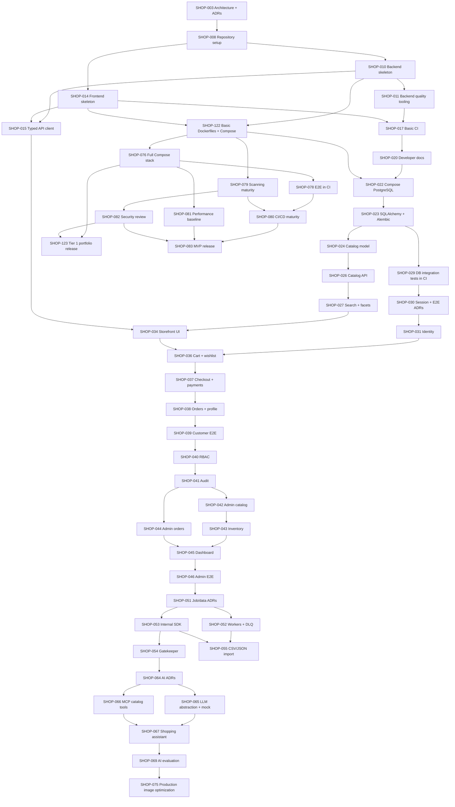

# eShop_AI — Implementation Roadmap

| Field | Value |
|---|---|
| Document | Implementation Roadmap |
| Version | 0.2 — Draft |
| Status | Approved by the project owner (2026-11-28, M0 exit); changes through pull requests |
| Jira | SHOP-002, SHOP-003, SHOP-004, SHOP-006, SHOP-007, SHOP-008, SHOP-009, SHOP-124 |
| Current milestone | M1 — Frontend and Backend Foundations, Local Development and Basic CI |
| Last updated | 2026-11-28 |
| Related | `docs/PRD.md` v0.3, `docs/ARCHITECTURE.md`, `docs/DECISIONS.md`, `CLAUDE.md`, `.claude/rules/` |

> **Implementation status:** M0 is closed (2026-11-28): SHOP-001 to
> SHOP-008 and SHOP-124 are complete; SHOP-009 (Jira configuration and
> import) and SHOP-125 are deferred. The project owner approved the M0
> documents and the start of M1. M1 is in progress: SHOP-010 (backend
> skeleton), SHOP-011 (backend quality tooling) and SHOP-012 (structured
> logging and error handling) are complete. Everything else from M1 onwards
> is **planned**.

## 1. How to Read This Roadmap

- **Milestones** M0–M11 are delivered in order. A milestone starts only
  after the previous milestone's exit criteria are met and the project
  owner approves the start.
- **Tracks:** `MVP` tasks deliver PRD `MVP` requirements. `ADV` tasks
  deliver advanced portfolio features. M0–M7 form the **MVP track**
  (MVP release at the end of M7); M8–M11 form the **advanced track**.
  `ADV` tasks inside M4–M6 are optional within those milestones and never
  block their exit; they can be deferred until after M7.
- **Task IDs** (`SHOP-NNN`) are permanent roadmap identifiers; Jira issue
  keys are mapped to them in `docs/jira/issue-map.csv` (section 10).
- **Priority** uses Jira levels: Highest, High, Medium, Low.
- **Effort** is in *ideal developer days* (focused work including
  implementation with Claude Code, review, tests and documentation).
- **PRD IDs** reference `docs/PRD.md`. Requirement-to-milestone mapping is
  in section 9.
- **Delivery tiers** (section 2.2) prioritize delivery *across* milestones:
  Tier 1 *Essential portfolio release*, Tier 2 *Advanced portfolio
  features*, Tier 3 *Optional production-grade enhancements*. Milestones
  define technical sequencing; tiers define what ships first. Not every
  backlog task is required for the initial portfolio release.

## 2. Planning Assumptions, Estimates and Delivery Tiers

### 2.1 Full-Scope Estimates

- One developer: a computer science graduate learning AWS and DevOps,
  developing with Claude Code.
- Realistic capacity: about **4 ideal days per week full-time** or about
  **2 ideal days per week part-time**.
- Buffers: **+25%** for MVP milestones, **+50%** for M8–M10 (first-time
  Kubernetes, Terraform and AWS work).
- Estimates are re-baselined after M1 using measured velocity.

| Milestone | Track | MVP days | ADV days | Buffered total | Full-time weeks | Part-time weeks |
|---|---|---|---|---|---|---|
| M0 Foundations | MVP | 9.5 | — | 11.9 | 3 | 5.9 |
| M1 App foundations, basic CI | MVP | 14.5 | — | 18.1 | 4.5 | 9.1 |
| M2 Database and catalog | MVP | 15.5 | — | 19.4 | 4.8 | 9.7 |
| M3 Storefront and checkout | MVP | 25 | — | 31.3 | 7.8 | 15.6 |
| M4 Admin and auditing | MVP | 17 | 6 | 28.8 | 7.2 | 14.4 |
| M5 SDK, jobs, Gatekeeper | MVP | 17.5 | 16.5 | 42.5 | 10.6 | 21.3 |
| M6 AI assistant and MCP | MVP | 19 | 8.5 | 34.4 | 8.6 | 17.2 |
| M7 Containers and mature CI/CD | MVP | 20 | — | 25 | 6.3 | 12.5 |
| M8 kind, Helm, Argo CD, Watchdog | ADV | — | 20.5 | 30.8 | 7.7 | 15.4 |
| M9 AWS evaluation and Terraform | ADV | — | 14.5 | 21.8 | 5.4 | 10.9 |
| M10 AWS deployment | ADV | — | 20.5 | 30.8 | 7.7 | 15.4 |
| M11 DevOps AI and portfolio | ADV | — | 17 | 21.3 | 5.3 | 10.6 |
| Advanced commerce backlog | ADV | — | 9 | 11.3 | 2.8 | 5.6 |
| **Total** | | **138** | **112.5** | **≈ 327** | **≈ 82** | **≈ 164** |

These full-scope figures are conservative, ideal-day estimates for every
task. The **full scope is not required for the first portfolio release**;
section 2.2 defines a focused Tier 1 delivery plan using AI-assisted
estimates. All estimates are re-baselined after M1 using measured velocity.

### 2.2 Portfolio Delivery Tiers

| Tier | Name | Purpose | Release |
|---|---|---|---|
| 1 | Essential portfolio release | Smallest complete, secure, tested, locally runnable store with a grounded AI assistant | `v0.1.0-portfolio` (SHOP-123), target 6–8 weeks |
| 2 | Advanced portfolio features | Remaining MVP capabilities plus DevOps showcase: imports and jobs, mature CI/CD, kind/Helm/Argo CD, observability, cost-approved AWS staging, DevOps AI | MVP release (SHOP-083) and later tags |
| 3 | Optional production-grade enhancements | Hardening and extras with lower portfolio value per effort | As time permits |

**Tier assignment** (task numbers are `SHOP-NNN`; every task belongs to
exactly one tier):

| Milestone | Tier 1 — Essential | Tier 2 — Advanced | Tier 3 — Optional |
|---|---|---|---|
| M0 | 001, 002, 003, 004, 005, 006, 007, 008, 009, 124, 125 | — | — |
| M1 | 010, 011, 012, 013, 014, 015, 016, 017, 018, 019, 020, 122 | — | — |
| M2 | 021, 022, 023, 024, 025, 026, 027, 029 | 028 | — |
| M3 | 030, 031, 032, 033, 034, 035, 036, 037, 038, 039 | — | — |
| M4 | 040, 041, 042, 043, 044, 045 | 046, 049 | 047, 048, 050 |
| M5 | 053, 054 | 051, 052, 055, 056, 057, 058, 063 | 059, 060, 061, 062 |
| M6 | 064, 065, 066, 067, 068, 069 | 070, 071 | 072, 073, 074 |
| M7 | 076, 079, 082, 123 | 075, 077, 078, 080, 081, 083 | — |
| M8 | — | 084, 085, 086, 087, 088, 089, 090, 091, 092 | — |
| M9 | — | 093, 094, 095, 096, 097, 098, 099 | — |
| M10 | — | 100, 101, 102, 103, 105, 106, 107 | 104, 108 |
| M11 | — | 109, 110, 111, 114, 115, 116 | 112, 113 |
| Backlog | — | — | 117, 118, 119, 120, 121 |

Tier 1 tasks depend only on Tier 1 tasks; Tier 2 tasks depend only on
Tier 1 or Tier 2 tasks (verified by the documentation validation script).

### 2.3 Essential Portfolio Release Plan (Tier 1)

**Target:** 8 weeks full-time (≈ 41 AI-assisted ideal days). A 6-week
delivery is possible only if M1 velocity is at least 30% higher than
assumed or if the de-scoping candidates below are applied.

| Week | Focus | Tier 1 tasks | AI-assisted days |
|---|---|---|---|
| 1 | Finish M0; start M1 | 003–009, 124, 125; 010–013 | 5.75 |
| 2 | Finish M1 (incl. basic containers); start M2 | 014–020, 122; 021, 022 | 4.5 |
| 3 | Finish M2 | 023–027, 029 | 5.25 |
| 4 | M3 identity, storefront and product pages | 030–035 | 5.25 |
| 5 | M3 cart, checkout, orders and end-to-end tests | 036–039 | 4.5 |
| 6 | M4 back office | 040–045 | 5.25 |
| 7 | M5 SDK and Gatekeeper; M6 foundations | 053, 054; 064–066; start 067 | 5 |
| 8 | Finish M6; Tier 1 M7; release | 067–069; 076, 079, 082, 123 | 5.5 |
| | **Total** | | **41** |

Per-milestone Tier 1 AI-assisted estimates (ideal days): M0 4 · M1 5.75
· M2 5.75 · M3 9.75 · M4 5.25 · M5 2 · M6 6.25 · M7 2.25.

**AI-assisted estimate basis:** Claude Code generates most boilerplate,
tests and documentation drafts; the developer designs, reviews every
change, debugs and makes decisions. Estimates are roughly 40% of the
conservative figures in section 2.1.

**Assumptions:**

- Full-time capacity of about 5 focused ideal days per week.
- Scope frozen to Tier 1 for the 8 weeks; no new features.
- Mock AI provider only (a real provider requires approval and is optional).
- No cloud work; everything runs locally with Docker Compose.
- Tests are written with each task, not afterwards.
- The re-estimation checkpoint at the end of week 2 (after M1) is honoured.

**Tier 1 release contents:** sign-in, storefront, search and facets,
product pages, comparison, cart, wishlist, simulated checkout with
transactional stock, orders, profile, RBAC, audit, admin catalog, inventory
and orders, basic dashboard, internal SDK, Gatekeeper, grounded AI
assistant with read-only MCP tools and evaluation, basic containers,
Compose, CI with scanning, security review.

**Excluded from Tier 1** (Tier 2 or 3): CSV/JSON imports and background
jobs, dead-letter queue, performance dataset and baseline, production
image optimization, end-to-end tests in CI, coverage gate, Kubernetes,
AWS and DevOps AI.

**PRD acceptance criteria met by Tier 1:** AC-001 to AC-020, AC-029,
AC-034 to AC-036, AC-040 to AC-046, AC-048, AC-049 (for the ports built in
Tier 1) and AC-054.

**Features likely to need additional time:**

| Feature | Why | Mitigation |
|---|---|---|
| Session cookies with server-side rendering and CSRF (SHOP-031, 032) | Cookie forwarding between Next.js server components and FastAPI is error-prone | Same-origin proxy design (ARCHITECTURE section 6.5); early spike in week 4 |
| Faceted search with counts (SHOP-027) | Query design and performance tuning | Limit filterable attributes for Tier 1 |
| Concurrent checkout correctness (SHOP-037) | Concurrency tests and transaction design | Single-transaction design (ARCHITECTURE section 7.5) |
| LangGraph and MCP integration (SHOP-066, 067) | New frameworks; evolving APIs | Keep the graph small; deterministic logic first |
| Accessibility fixes (SHOP-039) | Late discovery is costly | Use accessible primitives and run automated checks from week 4 |
| Review load of AI-generated code | Quality depends on careful review | Small tasks and pull requests; never merge unreviewed code |

**De-scoping candidates for a 6-week release:** simplify comparison to two
products (SHOP-035, −0.5 day), defer the dashboard (SHOP-045, −0.75),
defer admin customer views (SHOP-044, −0.75), reduce the AI evaluation
set to its minimum sizes (SHOP-069, −0.5), and defer wishlist (part of
SHOP-036, −0.5).

### 2.4 Approved Planning Decisions (SHOP-003)

| Decision | Reference |
|---|---|
| Early security scanning (Gitleaks, Dependabot, pip-audit, npm audit) from M1 | SHOP-018 |
| `backend/app/platform/` directory for platform components | ADR-0001, ARCHITECTURE section 3 |
| Internal integration SDK under `backend/app/integrations/` | ADR-0003 |
| AWS container platform decision deferred until cost evaluation | ADR-0006, UD-01, SHOP-093 |
| Basic Dockerfiles in M1, Compose expanded progressively, production optimization in M7 | ADR-0008, SHOP-122, SHOP-075 |
| No stock reservation for the initial checkout; transactional stock decrement | FR-CHK-007, ARCHITECTURE section 7.5 |
| Development MCP servers and additional Claude plugins deferred until a development task requires them; M0 exit does not depend on them (2026-11-25) | SHOP-125 |
| Jira configuration and backlog import deferred by the owner; the import files in `docs/jira/` are kept, and M0 exit does not depend on the import (2026-11-28) | SHOP-009 |

## 3. Milestone Overview

| ID | Milestone | Track | Key outcome | Depends on |
|---|---|---|---|---|
| M0 | Project initialization and engineering foundations | MVP | Approved documentation, ADRs, repository and Jira setup | — |
| M1 | Frontend and backend foundations, local development and basic CI | MVP | Running skeleton apps in basic containers, quality tooling, basic CI and security scanning | M0 |
| M2 | PostgreSQL, migrations, product catalog and demo data | MVP | Catalog API with search and facets over deterministic demo data | M1 |
| M3 | Customer authentication, storefront, search, cart and simulated checkout | MVP | Complete customer journey with simulated payment | M2 |
| M4 | Admin dashboard, inventory, order management and auditing | MVP | Operational back office with RBAC and audit trail | M3 |
| M5 | Internal SDK, integrations, product synchronization, jobs and Gatekeeper | MVP | Integration layer, background jobs, imports, quotas and DLQ | M4 |
| M6 | AI shopping assistant, MCP tools, provider abstraction and AI evaluation | MVP | Grounded assistant on the mock provider with evaluation suites | M5 |
| M7 | Docker, integration testing, security scanning and mature CI/CD | MVP | Tier 1 portfolio release; **MVP release:** production-optimized containers, mature gates, performance baseline | M6 |
| M8 | Local Kubernetes, Helm, Argo CD, monitoring and Watchdog | ADV | GitOps on kind with full observability | M7 |
| M9 | AWS architecture evaluation, Terraform, cost analysis and approved infrastructure | ADV | Approved cloud design, Terraform code, cost guardrails, minimal foundation | M8 |
| M10 | AWS deployment, promotion, GitOps, observability, rollback and incidents | ADV | Cost-approved staging (and optional demo) environment | M9 |
| M11 | DevOps AI assistant, automation, load testing, documentation and portfolio | ADV | DevOps AI, final documentation and portfolio package | M8 (M10 optional) |

## 4. Dependency Graphs

### 4.1 Milestone Dependencies

```mermaid
flowchart LR
  classDef mvp fill:#dbeafe,stroke:#1d4ed8,color:#0f172a
  classDef adv fill:#fef3c7,stroke:#b45309,color:#0f172a

  M0["M0 Foundations"]:::mvp --> M1["M1 App foundations + basic CI"]:::mvp
  M1 --> M2["M2 Database + catalog"]:::mvp
  M2 --> M3["M3 Storefront + checkout"]:::mvp
  M3 --> M4["M4 Admin + audit"]:::mvp
  M4 --> M5["M5 SDK, jobs, Gatekeeper"]:::mvp
  M5 --> M6["M6 AI assistant + MCP"]:::mvp
  M6 --> M7["M7 Containers + mature CI/CD (MVP release)"]:::mvp
  M7 --> M8["M8 kind, Helm, Argo CD, Watchdog"]:::adv
  M8 --> M9["M9 AWS evaluation + Terraform"]:::adv
  M9 --> M10["M10 AWS deployment"]:::adv
  M8 --> M11["M11 DevOps AI + portfolio"]:::adv
  M10 -. optional .-> M11
  M7 -. after MVP .-> ACB["Advanced commerce backlog"]:::adv
```

### 4.2 MVP Critical Path (tasks)

## 5. Cross-Cutting Capability Maturity

Basic testing, security, logging and CI start early; later milestones
**mature** them rather than introducing them for the first time.

| Capability | Introduced | Matured |
|---|---|---|
| Unit tests | M1 (SHOP-011) | Every milestone; 80% gate on critical logic in M7 (SHOP-080) |
| Integration tests (PostgreSQL) | M2 (SHOP-029) | Full suites and adapter contract tests in M7 (SHOP-077) |
| End-to-end tests | M3 (SHOP-039), run locally | Run in CI against containers in M7 (SHOP-078) |
| AI evaluation | M6 (SHOP-069) | DevOps AI evaluation in M11 (SHOP-111) |
| Performance testing | Dataset in M2 (SHOP-028) | Baseline in M7 (SHOP-081); at scale in M11 (SHOP-112) |
| Structured logging, correlation IDs | M1 (SHOP-012) | Tracing and metrics in M8 (SHOP-088); CloudWatch in M10 (SHOP-105) |
| Health checks | M1 (SHOP-013) | Probes and Watchdog in M8 (SHOP-086, SHOP-090) |
| Secrets scanning (Gitleaks) | M1 (SHOP-018) | Full history scans and blocking in M7 (SHOP-079) |
| Dependency scanning (Dependabot, pip-audit, npm audit) | M1 (SHOP-018), reporting | Blocking thresholds in M7 (SHOP-079) |
| Image and IaC scanning (Trivy) | M7 (SHOP-079) | IaC scanning of Terraform in M9 (SHOP-095) |
| Security headers, CORS | M1 (SHOP-019) | Sessions and CSRF in M3; OWASP review in M7 (SHOP-082) |
| Rate limiting | M3 (SHOP-033), library-based | Consolidated in Gatekeeper in M5 (SHOP-054) |
| Auditing | Security events in logs, M3 | Persistent audit service in M4 (SHOP-041) |
| Feature flags | M1 (SHOP-016), typed settings | Used to gate AI and providers in M5–M6 |
| Containers | M1 basic Dockerfiles and Compose (SHOP-122); Compose expanded with PostgreSQL (M2), Redis (M3) and worker (M5) | Production-optimized images and full-stack verification in M7 (SHOP-075, SHOP-076) |
| CI | M1 lint, types, tests (SHOP-017) | DB tests (M2), images and gates (M7), Terraform checks (M9), promotion (M10) |

## 6. Global Definition of Done

Every task follows the Definition of Done in `CLAUDE.md` section 15 and
the Task Completion Report in section 9. In addition, a roadmap task is
done only when:

- Linked PRD requirements and acceptance criteria are verified.
- CI is green on the task branch.
- Affected documentation (including ADRs and `docs/DECISIONS.md`) is updated.
- The project owner has approved any action listed in `CLAUDE.md` section 12.

Each milestone adds its own criteria below.

---

## 7. Milestones

### M0 — Project Initialization and Engineering Foundations

- **Objective:** establish approved product requirements, engineering
  standards, architecture decisions, repository conventions and planning.
- **Prerequisites:** none.
- **Technologies introduced:** Git, GitHub, Jira, Claude Code configuration
  (`CLAUDE.md`, `.claude/rules/`), Markdown and Mermaid.
- **Scope:** in: documentation, instructions, repository configuration.
  Out: application code, dependencies, infrastructure.

| ID | Task | Track | Priority | Effort | Depends on | Status |
|---|---|---|---|---|---|---|
| SHOP-001 | Engineering decisions and PRD | MVP | Highest | 1 | — | Done |
| SHOP-002 | Engineering refinement, Claude rules and roadmap | MVP | Highest | 1 | SHOP-001 | Done |
| SHOP-003 | Architecture document, ADR template, ADR-0001 to ADR-0008 and roadmap delivery tiers | MVP | Highest | 2 | SHOP-002 | Done |
| SHOP-004 | Security, development and contribution baseline: `SECURITY.md` (threat model), `DEVELOPMENT.md`, `CONTRIBUTING.md`, `.env.example`, VS Code settings and recommendations, reusable documentation validator (`scripts/validate_docs.py`); scope merged with SHOP-005 and parts of SHOP-006 and SHOP-007 | MVP | High | 1 | SHOP-003 | Done |
| SHOP-005 | Development and contribution guides (`DEVELOPMENT.md`, `CONTRIBUTING.md`) — delivered in SHOP-004 | MVP | High | 1 | SHOP-003 | Done (in SHOP-004) |
| SHOP-006 | `README.md` (the `DECISIONS.md` index was delivered in SHOP-003 and `.env.example` in SHOP-004) | MVP | High | 0.5 | SHOP-003, SHOP-005 | Done |
| SHOP-007 | Claude Code safeguards and repository conventions: project permission rules (allow, ask, deny), lightweight deterministic hooks in `.claude/hooks/`, plugin scope review, placeholder READMEs for empty directories, `.editorconfig`, `.gitattributes` (VS Code files delivered in SHOP-004) | MVP | High | 1 | SHOP-005 | Done (runtime safeguards verified 2026-11-25) |
| SHOP-008 | GitHub repository setup: record visibility (UD-11; public, verified in SHOP-006), MIT `LICENSE`, `main` ruleset (pull requests, no force pushes or deletion, no required approvals; required CI checks deferred to M1), private vulnerability reporting, Dependabot alerts, review of the merged Claude GitHub Actions workflows (approval required) | MVP | High | 0.5 | SHOP-006, SHOP-007 | Done (settings applied and verified 2026-11-25; PR #3) |
| SHOP-009 | Jira project setup and backlog import (section 10) | MVP | Medium | 0.5 | SHOP-002 | Deferred by the owner (2026-11-28): import files prepared in `docs/jira/`; Jira configuration and import not done; not an M0 exit requirement |
| SHOP-124 | Project-specific Claude skills and subagents in `.claude/skills/` and `.claude/agents/`, only where they provide measurable value (added in SHOP-007) | MVP | Medium | 0.5 | SHOP-007 | Done |
| SHOP-125 | Claude Code development MCP configuration (`.mcp.json`): servers, scopes, credentials handling and permission rules; external services only with approval (added in SHOP-007) | MVP | Medium | 0.5 | SHOP-007 | Deferred until a development task requires it (section 2.4); not an M0 exit requirement |

- **Deliverables:** PRD, ROADMAP, ARCHITECTURE, SECURITY, DEVELOPMENT,
  CONTRIBUTING, README, DECISIONS, ADR-0001 to ADR-0008, rules, Claude
  Code permissions, hooks, skills and subagents, repository and `LICENSE`.
  MCP configuration (SHOP-125) is deferred.
- **PRD requirements:** NFR-DOC-001, NFR-SEC-013, NFR-PORT-002 (skeleton).
- **Acceptance criteria:**
  - All documents required by `CLAUDE.md` section 13 exist, are non-empty
    and are mutually consistent.
  - PRD and roadmap IDs are unique (automated grep check).
  - ADR-0001 to ADR-0008 are accepted and indexed.
  - The initial commit is on GitHub with branch protection documented.
- **Required tests:** documentation consistency checks with
  `python3 scripts/validate_docs.py` and its self-tests (ID uniqueness,
  cross-references, dependencies, tiers, ADRs, links), Mermaid syntax
  review, `git check-ignore` checks.
- **Security considerations:** no secrets in the repository; `.gitignore`
  verified; Claude permission deny rules for high-risk commands.
- **Cost considerations:** zero; GitHub and Jira free tiers.
- **Definition of Done (additional):** owner review of every document.
- **Exit criteria:** SHOP-001 to SHOP-008 and SHOP-124 are done
  (SHOP-009 and SHOP-125 are deferred and do not block exit); the project
  owner approves the M0 documents and approves the start of M1.
- **Exit status:** met on 2026-11-28. The project owner approved the M0
  documents and the start of M1.

### M1 — Frontend and Backend Foundations, Local Development and Basic CI

- **Objective:** create runnable backend and frontend skeletons, packaged
  in basic containers, with quality tooling, logging, health checks,
  feature flags, a typed API client and a basic CI pipeline with security
  scanning.
- **Prerequisites:** M0 exit; UD-11 decided; repository on GitHub.
- **Technologies introduced:** Python 3.13, uv, FastAPI, Pydantic and
  Pydantic Settings, Ruff, mypy, pytest; Node.js LTS, npm, Next.js,
  React, TypeScript (strict), Tailwind CSS, shadcn/ui, ESLint, Prettier;
  OpenAPI type generator (UD-14); Docker (basic Dockerfiles); Docker
  Compose (backend and frontend services); GitHub Actions; Gitleaks;
  Dependabot; pip-audit; npm audit.
- **Scope:** in: skeletons, tooling, basic containers, CI, logging,
  health, flags, API client. Out: database, business features,
  production image optimization (M7).

| ID | Task | Track | Priority | Effort | Depends on | Status |
|---|---|---|---|---|---|---|
| SHOP-010 | Backend skeleton: uv project, FastAPI app factory, module layout, Pydantic Settings, graceful shutdown | MVP | Highest | 2 | SHOP-008 | Done (PR #8) |
| SHOP-011 | Backend quality tooling: Ruff, mypy, pytest with coverage; first unit tests | MVP | Highest | 1 | SHOP-010 | Done (PR #9) |
| SHOP-012 | Structured JSON logging, correlation ID middleware, safe error handler | MVP | High | 1.5 | SHOP-010 | Done (PR #11) |
| SHOP-013 | Liveness and readiness endpoints | MVP | High | 0.5 | SHOP-010 | Planned |
| SHOP-014 | Frontend skeleton: Next.js, TypeScript strict, Tailwind, shadcn/ui, ESLint, Prettier, base layout | MVP | Highest | 2 | SHOP-008 | Planned |
| SHOP-015 | Typed API client foundation: OpenAPI type generation, single client, CI drift check | MVP | High | 1.5 | SHOP-010, SHOP-014 | Planned |
| SHOP-016 | Typed configuration and feature flags (safe defaults); update `.env.example` | MVP | Medium | 1 | SHOP-010 | Planned |
| SHOP-017 | Basic CI: backend (Ruff, mypy, pytest) and frontend (lint, format, type check, build) with caching and path filters | MVP | Highest | 1.5 | SHOP-011, SHOP-014 | Planned |
| SHOP-018 | Basic security automation: Gitleaks, Dependabot, pip-audit and npm audit (reporting) | MVP | High | 1 | SHOP-017 | Planned |
| SHOP-019 | Security headers and CORS baseline (backend and Next.js) | MVP | High | 1 | SHOP-012, SHOP-014 | Planned |
| SHOP-020 | Update `DEVELOPMENT.md` with local setup and verification commands | MVP | Medium | 0.5 | SHOP-017 | Planned |
| SHOP-122 | Basic Dockerfiles for backend and frontend; initial Docker Compose running both applications (added in SHOP-003) | MVP | High | 1 | SHOP-010, SHOP-014 | Planned |

- **Deliverables:** runnable backend and frontend (natively and in basic
  containers), CI workflows, Dependabot configuration, generated API
  client, updated docs.
- **PRD requirements:** NFR-MNT-001 to 003, NFR-OBS-001, NFR-OBS-002,
  NFR-SEC-008 to 010, NFR-SEC-014, NFR-PORT-002, NFR-REL-008,
  FR-DEV-001 (basic), FR-DEV-002 (basic), FR-DEV-003, FR-DEV-005,
  FR-DEV-006, FR-PLAT-013, FR-PLAT-015 (foundation), NFR-COST-009.
- **Acceptance criteria:**
  - `uv run pytest`, `uv run ruff check`, `uv run mypy`, `npm run lint`,
    `npm run build` succeed locally and in CI.
  - `docker compose up` starts the backend and frontend; both health
    endpoints respond.
  - CI completes in under 10 minutes on a pull request.
  - Health endpoints return HTTP 200; logs are JSON with a request ID.
  - AC-048 (stale generated types fail CI).
  - AC-034 partially (lint, type, test and secrets-scan failures fail CI).
- **Required tests:** unit tests for settings, flags, logging middleware
  and error handler; API tests for health endpoints; frontend build test.
- **Security considerations:** no secrets in CI logs; least-privilege
  workflow permissions; actions pinned to commit SHAs; safe error output.
- **Cost considerations:** GitHub Actions free capacity; caching and path
  filters to minimize minutes.
- **Definition of Done (additional):** CI required on pull requests.
- **Exit criteria:** a new contributor can clone, set up and run both
  applications and all checks using `DEVELOPMENT.md` alone.

### M2 — PostgreSQL, Database Migrations, Product Catalog and Demo Data

- **Objective:** persist the catalog in PostgreSQL with migrations, expose
  catalog and search APIs, and seed deterministic demo data.
- **Prerequisites:** M1 exit; UD-07 decided in SHOP-021.
- **Technologies introduced:** PostgreSQL (added to the existing Compose
  stack), SQLAlchemy 2.x, Alembic, PostgreSQL search features as decided
  by UD-07.
- **Scope:** in: data model, migrations, catalog and search APIs, demo
  and performance datasets. Out: authentication, cart, admin UI.

| ID | Task | Track | Priority | Effort | Depends on |
|---|---|---|---|---|---|
| SHOP-021 | ADR: search implementation (UD-07) and data access conventions | MVP | High | 0.5 | SHOP-020 |
| SHOP-022 | Extend Docker Compose with PostgreSQL (health checks, localhost-only ports, named volume) | MVP | Highest | 1 | SHOP-020, SHOP-122 |
| SHOP-023 | SQLAlchemy setup, Alembic migrations, migration upgrade/downgrade check in CI | MVP | Highest | 2 | SHOP-022 |
| SHOP-024 | Catalog domain model: category hierarchy, attribute schemas, products, images, cents pricing, status, source metadata, availability categories | MVP | Highest | 3 | SHOP-021, SHOP-023 |
| SHOP-025 | Deterministic demo data seeder: ≥ 50 products across eight categories with specifications, prices, stock and labeled demo reviews | MVP | Highest | 2 | SHOP-024 |
| SHOP-026 | Catalog read API: categories, paginated listings, product details (availability categories only) | MVP | Highest | 2 | SHOP-024 |
| SHOP-027 | Search and facets API: keyword search with typo tolerance, facet counts, filters, sorting | MVP | High | 3 | SHOP-021, SHOP-026 |
| SHOP-028 | Synthetic performance dataset generator (10,000 products, 500 customers, 5,000 orders) | MVP | Medium | 1 | SHOP-025 |
| SHOP-029 | PostgreSQL integration tests in CI (service containers) | MVP | High | 1 | SHOP-023 |

- **Deliverables:** Compose file, migrations, catalog module, APIs,
  seeders, generator, integration test pipeline.
- **PRD requirements:** FR-CAT-002 to 004, FR-CAT-006, FR-CAT-010,
  FR-SRCH-001 to 007 (API), FR-IMP-006, FR-IMP-021, FR-IMP-024,
  FR-REV-001 and 002 (data), FR-DEV-018, NFR-MNT-004, NFR-PRIV-001.
- **Acceptance criteria:** AC-005, AC-006, AC-028, AC-029 (catalog APIs);
  migrations upgrade and downgrade cleanly on an empty database in CI.
- **Required tests:** unit tests for domain validation; integration tests
  for repositories and migrations; API tests for listing, filters, facet
  counts, sorting, pagination and invalid parameters.
- **Security considerations:** parameterized queries only; validated
  filter and sort parameters (allow-listed fields); local database
  credentials only in `.env`.
- **Cost considerations:** zero; local containers and CI service containers.
- **Definition of Done (additional):** demo data documented in `DEVELOPMENT.md`.
- **Exit criteria:** catalog and search APIs serve the demo dataset with
  all M2 tests passing in CI.

### M3 — Customer Authentication, Storefront, Search, Cart and Simulated Checkout

- **Objective:** deliver the complete customer journey from registration
  to simulated payment and order tracking.
- **Prerequisites:** M2 exit; UD-08 and the end-to-end tool (UD-12)
  decided in SHOP-030.
- **Technologies introduced:** Redis (session store, per UD-08), Argon2id
  hashing library, rate-limiting library, end-to-end test tool,
  automated accessibility checks.
- **Scope:** in: identity, storefront UI, product pages, comparison, cart,
  wishlist, checkout, payment simulator, orders, profile. Out: admin,
  background jobs, stock reservations (overselling is prevented by a
  single-transaction stock check-and-decrement, FR-CHK-007).

| ID | Task | Track | Priority | Effort | Depends on |
|---|---|---|---|---|---|
| SHOP-030 | ADRs: session store (UD-08) and end-to-end test tool (UD-12); add Redis to Compose | MVP | High | 0.5 | SHOP-029 |
| SHOP-031 | Identity module: registration, Argon2id, password policy, sign-in/out, server-side sessions, rotation, timeouts | MVP | Highest | 3 | SHOP-030 |
| SHOP-032 | CSRF protection with `Origin` verification; integrate in API client | MVP | Highest | 1.5 | SHOP-031, SHOP-015 |
| SHOP-033 | Rate limiting for sign-in, registration and search | MVP | High | 1 | SHOP-031 |
| SHOP-034 | Storefront UI: home, category listings, facets, sorting, URL state, breadcrumbs, responsive layout | MVP | Highest | 4 | SHOP-027, SHOP-015 |
| SHOP-035 | Product detail page with specifications and attribution; comparison view; demo reviews | MVP | High | 3 | SHOP-034 |
| SHOP-036 | Cart (guest and customer, merge, server-side totals, price-change notices) and wishlist | MVP | Highest | 3 | SHOP-031, SHOP-034 |
| SHOP-037 | Checkout: transactional stock check-and-decrement, idempotent order placement, payment simulator, order state machine | MVP | Highest | 4 | SHOP-036 |
| SHOP-038 | Order history, simulated tracking timeline, cancellation; profile and addresses | MVP | High | 2 | SHOP-037 |
| SHOP-039 | End-to-end tests for CW-01 to CW-07 and CW-09; automated accessibility checks | MVP | High | 3 | SHOP-035, SHOP-038 |

- **Deliverables:** identity, cart, checkout, payments and orders modules;
  storefront pages; end-to-end suite.
- **PRD requirements:** FR-AUTH-001 to 008, FR-CAT-001, 005, 007, 008,
  FR-SRCH-001 to 007 (UI), FR-PDP-001 to 003, FR-CMP-001 to 003,
  FR-CART-001 to 005, FR-WISH-001, 002, FR-CHK-001 to 003, 005 to 007,
  FR-PAY-001 to 005, FR-ORD-001 to 006, FR-PROF-001, 002, FR-REV-001, 002,
  NFR-SEC-001 to 007, NFR-SEC-015, NFR-SEC-019, NFR-REL-001, 002,
  NFR-USE-001 to 003, NFR-ACC-001, 002, NFR-COMP-001, NFR-LOC-001.
- **Acceptance criteria:** AC-001 to AC-004, AC-007 to AC-018, AC-029
  (UI); AC-032 for customer pages.
- **Required tests:** unit tests for password policy, cart totals, order
  state machine and payment simulator; integration tests for sessions and
  transactional stock updates; concurrency test for overselling; API tests including
  CSRF and authorization failures; end-to-end workflow tests.
- **Security considerations:** session cookie attributes, CSRF, account
  enumeration, rate limits, object-level authorization, no card inputs,
  output encoding.
- **Cost considerations:** zero.
- **Definition of Done (additional):** simulated-payment notice verified
  on every payment page.
- **Exit criteria:** a customer can complete CW-01 to CW-09 (except CW-08)
  end to end locally, with all tests passing in CI.

### M4 — Admin Dashboard, Inventory, Order Management and Auditing

- **Objective:** deliver a secure back office with RBAC, catalog and
  inventory management, order processing, dashboard and audit logging.
- **Prerequisites:** M3 exit.
- **Technologies introduced:** frontend charting library (selected in
  SHOP-045), TOTP library (ADV only).
- **Scope:** in: RBAC, audit service, admin UI and APIs. Out: imports and
  background jobs (M5).

| ID | Task | Track | Priority | Effort | Depends on |
|---|---|---|---|---|---|
| SHOP-040 | RBAC: roles, permissions, authorization dependencies, object-level checks, role assignment; admin route sweep test | MVP | Highest | 2.5 | SHOP-039 |
| SHOP-041 | Audit logging service: append-only entries with actor, action, target and redacted changes; audit search | MVP | Highest | 2 | SHOP-040 |
| SHOP-042 | Admin product and category management with attribute schema validation; archive over delete | MVP | Highest | 4 | SHOP-040, SHOP-041 |
| SHOP-043 | Inventory management: movements with reasons, low-stock threshold | MVP | High | 2 | SHOP-042 |
| SHOP-044 | Admin order management and customer views (masked personal fields, disable account) | MVP | High | 2.5 | SHOP-041 |
| SHOP-045 | Admin dashboard KPIs (revenue, orders, AOV, low stock, import status placeholder until M5) | MVP | Medium | 2 | SHOP-043, SHOP-044 |
| SHOP-046 | End-to-end tests for AW-01, AW-05, AW-06 and AW-07 | MVP | High | 2 | SHOP-045 |
| SHOP-047 | TOTP multi-factor authentication for back-office users | ADV | Low | 2 | SHOP-040 |
| SHOP-048 | Session management: view and revoke active sessions | ADV | Low | 1 | SHOP-031 |
| SHOP-049 | Fine-grained roles: Catalog Manager, Order Manager, DevOps Operator | ADV | Medium | 1.5 | SHOP-040 |
| SHOP-050 | Dashboard trends, top products and category performance | ADV | Low | 1.5 | SHOP-045 |

- **Deliverables:** admin module and UI, audit service, dashboard.
- **PRD requirements:** FR-ADM-001 to 012, FR-ADM-014, FR-PLAT-011,
  NFR-SEC-005, NFR-SEC-019; ADV: FR-AUTH-010, FR-AUTH-011, FR-ADM-013.
- **Acceptance criteria:** AC-019, AC-020; admin end-to-end tests pass.
- **Required tests:** authorization matrix tests for every role and admin
  route; audit entry tests for every write; inventory movement tests;
  order transition tests from the admin side.
- **Security considerations:** privilege escalation, mass assignment,
  masked personal data, audit integrity (no update or delete paths),
  stricter admin session timeouts.
- **Cost considerations:** zero.
- **Definition of Done (additional):** permission matrix documented in
  `docs/SECURITY.md`.
- **Exit criteria:** AW-01, AW-05, AW-06 and AW-07 pass end to end; every
  back-office write is audited.

### M5 — Internal SDK, External Integrations, Product Synchronization, Background Jobs and Gatekeeper

- **Objective:** introduce the integration layer, background workers,
  scheduled jobs, bounded retries, dead-letter handling, Gatekeeper and
  product imports.
- **Prerequisites:** M4 exit; UD-03, UD-04 and UD-09 decided in SHOP-051.
- **Technologies introduced:** background job framework and scheduler
  (UD-04), shared async HTTP client, retry utilities (library or framework
  built-ins), official SDKs of approved data sources (ADV), local mail
  catcher (UD-15, ADV); worker service added to Compose.
- **Scope:** in (MVP): workers, schedules, retries, DLQ, internal SDK,
  Gatekeeper, CSV/JSON import, job administration. ADV: notifications,
  external adapters, price sync, circuit breakers, image ingestion.

| ID | Task | Track | Priority | Effort | Depends on |
|---|---|---|---|---|---|
| SHOP-051 | ADRs: job runner (UD-04), data sources (UD-03), image storage (UD-09) | MVP | Highest | 1.5 | SHOP-046 |
| SHOP-052 | Workers and scheduler: persisted job states, idempotent handlers, bounded retries, DLQ, single-run schedules; expired session and stale guest-cart cleanup job | MVP | Highest | 4 | SHOP-051 |
| SHOP-053 | Internal SDK and integration layer: ports, shared HTTP client, adapter conventions, mocks, contract test harness (follows ADR-0003) | MVP | High | 3 | SHOP-045 |
| SHOP-054 | Gatekeeper: inbound rate limits, outbound quotas, AI token budgets, fallbacks | MVP | High | 3 | SHOP-053 |
| SHOP-055 | CSV/JSON import: dry run, validation, idempotent upsert, GTIN/MPN duplicate detection, price history, job history, retry | MVP | Highest | 4 | SHOP-052, SHOP-053 |
| SHOP-056 | Admin UI for jobs, dead-letter queue and price history | MVP | High | 2 | SHOP-055 |
| SHOP-057 | Notification management (in-app and local mail catcher) and password reset | ADV | Medium | 3 | SHOP-052 |
| SHOP-058 | First authorized external source adapter with caching, quotas and `Retry-After` handling | ADV | Medium | 4 | SHOP-054, SHOP-055 |
| SHOP-059 | Scheduled price synchronization, change-threshold approval and seeded price simulator | ADV | Medium | 3 | SHOP-052, SHOP-055 |
| SHOP-060 | Circuit breaker for external sources (if failure data justifies it) | ADV | Low | 1 | SHOP-058 |
| SHOP-061 | Fuzzy duplicate review and failed-record retry | ADV | Low | 2 | SHOP-055 |
| SHOP-062 | Safe remote image ingestion (allow-lists, SSRF protection, re-encoding, license tracking) | ADV | Medium | 2 | SHOP-058 |
| SHOP-063 | Expand demo dataset to ≥ 500 products | ADV | Medium | 1.5 | SHOP-055 |

- **Deliverables:** `backend/app/integrations/`, `backend/app/platform/`
  components, import module, job administration UI.
- **PRD requirements:** FR-PLAT-001 to 004, 007 to 009, 014, 016,
  FR-IMP-001 to 008, 010, 014 to 016, NFR-SEC-011, NFR-SEC-012,
  NFR-REL-004, NFR-TST-002, NFR-PERF-009, NFR-COST-007; ADV: FR-AUTH-009,
  FR-PLAT-010, FR-PLAT-012, FR-IMP-009, 011 to 013, 017 to 020, 022, 023,
  NFR-SEC-017.
- **Acceptance criteria:** AC-021 to AC-026, AC-046, AC-047, AC-049;
  ADV: AC-027.
- **Required tests:** idempotency and retry tests; DLQ tests; schedule
  single-execution tests; Gatekeeper limit and fallback tests; import
  validation and duplicate tests; adapter contract tests with recorded
  fixtures; no outbound network during tests.
- **Security considerations:** upload limits, CSV formula injection, SSRF,
  untrusted source data (also a prompt-injection vector for M6), provider
  credentials in environment variables only, source terms compliance.
- **Cost considerations:** free authorized sources only; external
  schedules disabled by default; quotas prevent accidental overuse.
- **Definition of Done (additional):** each adapter documents source
  terms, rate limits and attribution requirements.
- **Exit criteria:** AW-02, AW-03 and AW-04 (with demo data) pass end to
  end; MVP platform components operate with mock providers.

### M6 — AI Shopping Assistant, MCP Tools, Provider Abstraction and AI Evaluation

- **Objective:** deliver a grounded shopping assistant using LangGraph and
  read-only MCP tools, running on a mock provider with automated
  evaluation.
- **Prerequisites:** M5 exit (SDK and Gatekeeper); UD-06 and UD-10
  decided in SHOP-064.
- **Technologies introduced:** LangGraph, MCP SDK, LLM provider SDK(s)
  behind the integration layer (disabled by default), evaluation harness.
- **Scope:** in (MVP): provider abstraction, mock provider, MCP catalog
  tools, assistant, UI, evaluation, AI telemetry. ADV: streaming,
  semantic retrieval, external MCP access, real-provider evaluation.

| ID | Task | Track | Priority | Effort | Depends on |
|---|---|---|---|---|---|
| SHOP-064 | ADRs: LLM provider strategy and token budget (UD-06), MCP transport (UD-10) | MVP | Highest | 1 | SHOP-054 |
| SHOP-065 | LLM provider abstraction, deterministic mock provider, structured output validation; first real adapter disabled by default | MVP | Highest | 3 | SHOP-064, SHOP-053 |
| SHOP-066 | MCP catalog tools (search, get, compare, categories, availability) with server-side authorization | MVP | Highest | 3 | SHOP-064 |
| SHOP-067 | LangGraph shopping assistant: intent parsing, deterministic recommendations, grounding validation, refusals, session state, configurable limits | MVP | Highest | 5 | SHOP-065, SHOP-066 |
| SHOP-068 | Assistant UI with product cards rendered from live data; keyword-search fallback | MVP | High | 3 | SHOP-067 |
| SHOP-069 | AI evaluation suite (≥ 30 queries) and prompt-injection suite (≥ 20 cases) in CI | MVP | Highest | 3 | SHOP-067 |
| SHOP-070 | AI telemetry: provider, model, tokens, latency, outcome (no content) | MVP | High | 1 | SHOP-067 |
| SHOP-071 | Streaming assistant responses | ADV | Medium | 1.5 | SHOP-068 |
| SHOP-072 | Semantic retrieval with embeddings (ADR required) | ADV | Low | 4 | SHOP-067 |
| SHOP-073 | External MCP client access to public catalog tools | ADV | Low | 2 | SHOP-066 |
| SHOP-074 | Real-provider evaluation run (requires paid API approval) | ADV | Low | 1 | SHOP-069 |

- **Deliverables:** `backend/app/modules/ai/`, MCP tools, assistant UI,
  `tests/ai/` evaluation suites, AI ADRs.
- **PRD requirements:** FR-AI-001 to 010, FR-AI-020, FR-AI-021,
  NFR-AI-001 to 005, NFR-AI-010 to 017, NFR-PERF-007, NFR-REL-003,
  NFR-COST-006, FR-CAT-010 (AI tools); ADV: FR-AI-011, FR-AI-012,
  FR-AI-022, FR-SRCH-009, NFR-PERF-008.
- **Acceptance criteria:** AC-040 to AC-045, AC-029 (AI tool outputs).
- **Required tests:** unit tests for intent parsing schemas and grounding
  validation; tool authorization tests; evaluation and injection suites on
  the mock provider; fallback tests with AI disabled; limit tests.
- **Security considerations:** indirect prompt injection via product data,
  tool authorization independent of the model, no personal data in
  prompts, content-free telemetry.
- **Cost considerations:** mock provider by default; any paid API needs
  explicit approval, a daily token budget (UD-06) and Gatekeeper limits.
- **Definition of Done (additional):** AI behaviour and limits documented
  in `docs/ARCHITECTURE.md` and `docs/SECURITY.md`.
- **Exit criteria:** CW-08 passes end to end on the mock provider and all
  AI evaluation suites pass in CI.

### M7 — Docker, Integration Testing, Security Scanning and Mature CI/CD (MVP Release)

- **Objective:** optimize containers for production, mature the test,
  security and CI/CD pipelines, measure baseline performance, and deliver
  the Tier 1 portfolio release followed by the MVP release.
- **Prerequisites:** M6 exit (Tier 1 tasks only for SHOP-123).
- **Technologies introduced:** production-optimized images (hardened
  multi-stage builds, minimal bases), Trivy (image and IaC scanning,
  SBOM), container registry for CI images (selected by ADR; free option
  preferred), load-testing tool (UD-12), Lighthouse CI.
- **Scope:** in: production container optimization, full-stack Compose
  verification, integration and contract suites, CI end-to-end, scanning
  thresholds, quality gates, performance baseline, security review,
  releases. Out: Kubernetes, cloud.

| ID | Task | Track | Priority | Effort | Depends on |
|---|---|---|---|---|---|
| SHOP-075 | Production-optimized images for backend, worker and frontend: hardening, minimal bases, non-root, size and build-cache optimization | MVP | Highest | 2.5 | SHOP-069 |
| SHOP-076 | Full-stack Docker Compose profiles and one-command verification of the complete local stack | MVP | Highest | 2 | SHOP-122 |
| SHOP-077 | Integration and contract test suite expansion | MVP | High | 3 | SHOP-076 |
| SHOP-078 | End-to-end tests in CI against the containerized stack | MVP | Highest | 2 | SHOP-076 |
| SHOP-079 | Security scanning maturity: Trivy image and IaC scans, blocking thresholds, Gitleaks history scan, SBOM | MVP | Highest | 2 | SHOP-122 |
| SHOP-080 | CI/CD maturity: required checks, branch protection, 80% coverage gate on critical modules, image build and publish from `main`, versioning | MVP | High | 2 | SHOP-078, SHOP-079 |
| SHOP-081 | Performance baseline on PE-1, Lighthouse CI and accessibility automation | MVP | High | 3 | SHOP-076 |
| SHOP-082 | Security review against OWASP Top 10 and OWASP Top 10 for LLM Applications; log leakage scan | MVP | Highest | 2 | SHOP-079 |
| SHOP-083 | MVP release: version tag, release notes, documentation update | MVP | Highest | 1 | SHOP-080, SHOP-081, SHOP-082 |
| SHOP-123 | Tier 1 essential portfolio release `v0.1.0-portfolio`: release checklist, notes, demo script, README showcase (added in SHOP-003) | MVP | Highest | 0.5 | SHOP-045, SHOP-069, SHOP-076, SHOP-082 |

- **Deliverables:** Dockerfiles, Compose profiles, mature workflows,
  performance report, security review, MVP release.
- **PRD requirements:** FR-DEV-001, 002, 004, 006 (blocking), 007, 008,
  NFR-PORT-001, NFR-TST-001, NFR-TST-003, NFR-SEC-018, NFR-SEC-020 (local
  review), NFR-PERF-001 to 006, NFR-PERF-009.
- **Acceptance criteria:** AC-026, AC-030 to AC-036, AC-054.
- **Required tests:** full unit, integration, contract, API, end-to-end,
  AI evaluation, security, performance and accessibility suites.
- **Security considerations:** image hardening, supply chain (SBOM, pinned
  bases), blocking critical vulnerabilities, registry access control.
- **Cost considerations:** prefer free registries and CI capacity; no
  cloud resources.
- **Definition of Done (additional):** release notes list known
  limitations and deferred `ADV` items.
- **Exit criteria:** **MVP release:** all `MVP` acceptance criteria in PRD
  section 19 pass; the project owner approves the MVP.

### M8 — Local Kubernetes, Helm, Argo CD, Monitoring and Watchdog

- **Objective:** run the application on a local kind cluster through Helm
  and Argo CD with metrics, tracing, dashboards, alerts and Watchdog.
- **Prerequisites:** M7 exit; developer machine meets documented resource
  requirements.
- **Technologies introduced:** kind, kubectl, Helm, Argo CD, Prometheus,
  Alertmanager, Grafana, OpenTelemetry SDK and Collector, log aggregation
  (per ADR).
- **Scope:** in: local Kubernetes only. Out: cloud clusters.

| ID | Task | Track | Priority | Effort | Depends on |
|---|---|---|---|---|---|
| SHOP-084 | ADR: local Kubernetes topology and observability stack | ADV | High | 1 | SHOP-083 |
| SHOP-085 | kind cluster bootstrap scripts (idempotent, documented resources) | ADV | Highest | 1.5 | SHOP-084 |
| SHOP-086 | Helm charts for frontend, backend and worker: probes, resources, non-root, per-environment values; lint and template in CI | ADV | Highest | 4 | SHOP-085 |
| SHOP-087 | Argo CD on kind with GitOps applications | ADV | High | 2.5 | SHOP-086 |
| SHOP-088 | OpenTelemetry tracing and Prometheus metrics (RED, jobs, Gatekeeper usage, AI) | ADV | High | 3 | SHOP-084 |
| SHOP-089 | Prometheus, Grafana and Alertmanager: dashboards and alert rules as code | ADV | High | 3 | SHOP-086, SHOP-088 |
| SHOP-090 | Watchdog: dependency health aggregation, queue and DLQ depth, stale schedule detection, alerts | ADV | Medium | 3 | SHOP-089 |
| SHOP-091 | Rollback rehearsal on kind and rollback runbook | ADV | High | 1.5 | SHOP-087 |
| SHOP-092 | Local Kubernetes secrets handling (no plaintext secrets in Git) | ADV | High | 1 | SHOP-086 |

- **Deliverables:** `deployment/helm/`, kind scripts, Argo CD manifests,
  `monitoring/` dashboards and alerts, Watchdog, runbook.
- **PRD requirements:** FR-DEV-011 to 013, 015 to 017, 019, FR-PLAT-005,
  FR-PLAT-006, NFR-OBS-003.
- **Acceptance criteria:** AC-052, AC-053 (local), AC-056.
- **Required tests:** Helm lint and template tests in CI; smoke tests
  after Argo CD sync; alert rule tests; Watchdog failure-injection tests.
- **Security considerations:** non-root pods, network exposure limited to
  localhost, secrets outside Git, dashboards without personal data.
- **Cost considerations:** zero cloud cost; local resource usage
  documented; observability components optional via profiles.
- **Definition of Done (additional):** cluster can be recreated from
  scratch with one documented command.
- **Exit criteria:** application deploys to kind from Git via Argo CD,
  with dashboards and alerts working and a rehearsed rollback.

### M9 — AWS Architecture Evaluation, Terraform, Cost Analysis and Approved Cloud Infrastructure

- **Objective:** select a cost-appropriate AWS architecture, write and
  validate Terraform, establish cost and security guardrails, and create
  only the approved foundational resources.
- **Prerequisites:** M8 exit (cloud evaluation may start after M7); an AWS
  account with MFA owned by the project owner; UD-05 budget defined.
- **Technologies introduced:** Terraform, AWS IAM (OIDC for GitHub
  Actions), AWS Budgets, VPC, ECR, S3 (remote state), AWS Pricing Calculator.
- **Scope:** in: evaluation, ADRs, Terraform code, offline validation,
  guardrails and approved foundation. Out: application deployment (M10).

| ID | Task | Track | Priority | Effort | Depends on |
|---|---|---|---|---|---|
| SHOP-093 | AWS architecture options and cost analysis; ADRs for UD-01, UD-02, UD-09 and secrets service | ADV | Highest | 3 | SHOP-083 |
| SHOP-094 | AWS account security baseline: MFA, no root usage, least-privilege roles, GitHub OIDC (approval required) | ADV | Highest | 2 | SHOP-093 |
| SHOP-095 | Terraform structure and modules; `fmt`, `validate`, static analysis and Trivy IaC scans in CI (no AWS access) | ADV | Highest | 2.5 | SHOP-093 |
| SHOP-096 | Cost guardrails: AWS Budgets alerts, tagging policy, teardown procedure (approval required) | ADV | Highest | 1 | SHOP-094 |
| SHOP-097 | Remote Terraform state with encryption and locking (approval required) | ADV | High | 1 | SHOP-095, SHOP-096 |
| SHOP-098 | Foundational infrastructure: VPC (no NAT by default), ECR, IAM roles; reviewed plan, approved apply | ADV | High | 3 | SHOP-097 |
| SHOP-099 | Data and secrets layer design: database option, backups, secrets service; Terraform modules (no apply until M10) | ADV | High | 2 | SHOP-095 |

- **Deliverables:** architecture and cost ADRs, `infrastructure/terraform/`,
  cost report, budgets, OIDC roles, foundation resources (if approved).
- **PRD requirements:** FR-DEV-009, FR-DEV-010, FR-DEV-014, NFR-SEC-016,
  NFR-COST-002 to 005, NFR-COST-010.
- **Acceptance criteria:** AC-055; budgets configured before any other
  resource; every created resource is tagged and listed in the cost report.
- **Required tests:** Terraform `fmt` and `validate`, IaC scans, plan
  review checklist, teardown dry-run documentation.
- **Security considerations:** no long-lived access keys, OIDC scoped to
  repository and branch, least-privilege policies, encrypted state.
- **Cost considerations:** indicative fixed costs to evaluate (us-east-1,
  verify with the AWS Pricing Calculator): managed Kubernetes control plane
  ≈ $0.10/hour (≈ $73/month); NAT gateway ≈ $0.045/hour plus data
  processing; public IPv4 ≈ $0.005/hour per address; Secrets Manager
  ≈ $0.40 per secret per month. Prefer designs that avoid always-on
  fixed costs.
- **Definition of Done (additional):** every approval decision recorded
  with date and estimated cost.
- **Exit criteria:** the project owner approves the cloud architecture,
  the cost estimate per environment and the M10 deployment plan.

### M10 — AWS Deployment, Environment Promotion, GitOps, Observability, Rollback and Incident Management

- **Objective:** deploy cost-approved staging (and optionally a demo
  production) environment with promotion, observability, backups,
  rollback and incident procedures.
- **Prerequisites:** M9 exit; approved cost estimate per environment.
- **Technologies introduced:** the selected container platform (UD-01),
  managed PostgreSQL or the approved alternative, CloudFront (per UD-02),
  CloudWatch, Secrets Manager or SSM Parameter Store, GitHub environments.
- **Scope:** in: staging, promotion, cloud observability, backups,
  rollback, incident runbooks, optional demo environment. Out:
  multi-region, formal SLAs.

| ID | Task | Track | Priority | Effort | Depends on |
|---|---|---|---|---|---|
| SHOP-100 | Cloud secrets management (approved service) | ADV | Highest | 1.5 | SHOP-099 |
| SHOP-101 | Ephemeral staging environment deployment (approval required) | ADV | Highest | 4 | SHOP-098, SHOP-100 |
| SHOP-102 | Frontend delivery per UD-02 | ADV | High | 2 | SHOP-101 |
| SHOP-103 | Environment promotion: same image SHA from staging to demo with manual approval gates | ADV | High | 2.5 | SHOP-101 |
| SHOP-104 | GitOps in the cloud: Argo CD if Kubernetes-based, otherwise declarative GitHub Actions deployment | ADV | Medium | 2 | SHOP-103 |
| SHOP-105 | Cloud observability: CloudWatch logs, metrics, alarms, OpenTelemetry export, retention limits | ADV | High | 3 | SHOP-101 |
| SHOP-106 | Backup and restore test; RPO and RTO verification | ADV | High | 1.5 | SHOP-101 |
| SHOP-107 | Cloud rollback procedure and incident management runbooks (severity levels, postmortem template) | ADV | High | 2 | SHOP-103, SHOP-105 |
| SHOP-108 | Optional demo production environment with demo windows and automated teardown (approval required) | ADV | Medium | 2 | SHOP-107 |

- **Deliverables:** running staging environment, promotion pipeline,
  dashboards and alarms, runbooks, teardown automation.
- **PRD requirements:** FR-DEV-013 (cloud), FR-DEV-014, 015, 017, 020,
  NFR-REL-005 to 007, NFR-COST-003, NFR-COST-008, NFR-SEC-020 (before
  public deployment).
- **Acceptance criteria:** AC-053 (cloud); staging and demo run the same
  image SHA; restore test meets RPO ≤ 24 h and RTO ≤ 4 h; teardown removes
  all environment resources.
- **Required tests:** post-deployment smoke tests, promotion tests,
  rollback drill, restore drill, alarm tests.
- **Security considerations:** TLS everywhere, no public database,
  security groups least privilege, secrets from the managed service,
  security review completed before any public endpoint.
- **Cost considerations:** environments ephemeral by default; actual spend
  compared with the estimate weekly; teardown after demos.
- **Definition of Done (additional):** actual monthly cost documented.
- **Exit criteria:** staging deploys, promotes and rolls back reliably
  within approved cost, and the teardown procedure is verified.

### M11 — DevOps AI Assistant, Advanced Automation, Load Testing, Final Documentation and Portfolio Preparation

- **Objective:** deliver the read-only DevOps AI assistant, scale testing,
  final documentation and a polished portfolio package.
- **Prerequisites:** M8 exit (logs, metrics, alerts) and M6 AI foundation;
  M10 optional.
- **Technologies introduced:** read-only GitHub API access for CI data;
  Jira API for drafts (submission only with approval).
- **Scope:** in: DevOps AI, load testing, automation, documentation,
  portfolio. Out: autonomous remediation.

| ID | Task | Track | Priority | Effort | Depends on |
|---|---|---|---|---|---|
| SHOP-109 | DevOps AI read-only integrations: log queries, CI failures, alerts, with redaction | ADV | High | 3 | SHOP-089, SHOP-067 |
| SHOP-110 | Incident reports, remediation suggestions and Jira incident drafts with human approval | ADV | High | 3 | SHOP-109 |
| SHOP-111 | DevOps AI evaluation suite with recorded incident fixtures | ADV | High | 2 | SHOP-110 |
| SHOP-112 | Load testing at scale (staging if available, otherwise kind) | ADV | Medium | 2 | SHOP-081 |
| SHOP-113 | Advanced automation: idle-environment teardown schedules, dependency update policy | ADV | Low | 2 | SHOP-080 |
| SHOP-114 | Final documentation: architecture diagrams, ADR review, documentation reflects actual state | ADV | Highest | 2 | SHOP-111 |
| SHOP-115 | Portfolio preparation: demo script, recording, screenshots, README showcase, cost report, lessons learned | ADV | High | 2 | SHOP-114 |
| SHOP-116 | Final security review and cloud teardown or hibernation plan | ADV | Highest | 1 | SHOP-115 |

- **Deliverables:** DevOps AI module, evaluation suite, load-test report,
  final documentation, portfolio assets.
- **PRD requirements:** FR-OPSAI-001 to 009, FR-AI-022 (if not done),
  NFR-PERF-008, NFR-COST-003.
- **Acceptance criteria:** AC-050, AC-051; load-test report published;
  all documents reflect the actual state.
- **Required tests:** DevOps AI evaluation and redaction tests, approval
  gating tests, load tests.
- **Security considerations:** read-only tokens with minimal scopes,
  secret redaction before LLM calls, no outward action without approval.
- **Cost considerations:** mock provider for evaluation; any paid usage
  within the approved token budget; cloud resources torn down or
  hibernated at the end.
- **Definition of Done (additional):** portfolio reviewed by the owner.
- **Exit criteria:** the project owner accepts the final portfolio
  release.

### Advanced Commerce Backlog (unscheduled, after M7)

| ID | Task | Track | Priority | Effort | Depends on | PRD |
|---|---|---|---|---|---|---|
| SHOP-117 | Customer review submission and moderation | ADV | Medium | 2 | SHOP-083 | FR-REV-003, 004 |
| SHOP-118 | Price history chart, lowest 30-day price and wishlist price-drop indicator | ADV | Low | 1.5 | SHOP-083 | FR-PDP-004, FR-WISH-003 |
| SHOP-119 | Related products, recently viewed products and search autocomplete | ADV | Low | 2.5 | SHOP-083 | FR-PDP-005, FR-CAT-009, FR-SRCH-008 |
| SHOP-120 | Simulated refunds and automated tracking progression | ADV | Low | 1.5 | SHOP-083 | FR-PAY-006, FR-ORD-007 |
| SHOP-121 | Account deletion (anonymization) and personal data export | ADV | Low | 1.5 | SHOP-083 | FR-PROF-003, 004 |

---

## 8. Local-to-Cloud Transition Plan

The project moves to the cloud in gated stages. Each stage is reversible,
and no stage that costs money starts without explicit approval.

| Stage | Milestone | Environment | Gate to enter | Cost | Exit / rollback |
|---|---|---|---|---|---|
| L0 | M1–M6 | Native apps or basic containers; Compose expanded progressively | — | $0 | `docker compose down` |
| L1 | M7 | Production-optimized containerized Compose stack | MVP tests green | $0 | `docker compose down -v` (deletes local data) |
| L2 | M8 | kind with Helm, Argo CD and observability | M7 exit | $0 | Delete kind cluster |
| L3 | M9 | Terraform written and validated offline; cost analysis | M8 exit | $0 | n/a |
| L4 | M9 | Budgets, IAM/OIDC, remote state, VPC and ECR | Approved cost estimate and owner approval | Low, mostly usage-based | `terraform destroy` (approval) |
| L5 | M10 | Ephemeral staging | Approved environment estimate | Usage-based while running | Teardown after each session |
| L6 | M10 | Optional demo production during demo windows | Security review complete; approval | Usage-based while running | Automated teardown |

**Technology placement** — not every technology is deployed to AWS:

| Technology | Local (L0–L1) | kind (L2) | AWS (L4–L6), if approved |
|---|---|---|---|
| Frontend | Dev server / container | Helm release | Per UD-02 (container or static delivery via CloudFront) |
| Backend and worker | Native / container | Helm release | Per UD-01 container platform |
| PostgreSQL | Container | In-cluster | Managed database or approved lower-cost alternative |
| Redis | Container | In-cluster | Decided in M9 by cost (managed, self-hosted or removed for staging) |
| Argo CD | — | Yes | Only if UD-01 selects a Kubernetes-based platform |
| Prometheus and Grafana | Optional profile | Yes | Not by default; CloudWatch first |
| OpenTelemetry | Optional collector | Yes | Export to the approved AWS backend |
| Mail catcher | Container | Optional | Not deployed |
| LLM provider | Mock | Mock | Mock by default; real provider only with approval |
| Secrets | `.env` | Kubernetes Secrets created locally | Approved managed secrets service |
| Container images | Local build | Loaded into kind | ECR or an approved free registry |

## 9. Requirement-to-Milestone Traceability Matrix

| PRD requirements | Area | Milestone | Tasks | Acceptance criteria |
|---|---|---|---|---|
| FR-AUTH-001 to 008 | Authentication | M3 | SHOP-031, 032, 033 | AC-001 to 004 |
| FR-AUTH-009 | Password reset | M5 (ADV) | SHOP-057 | — |
| FR-AUTH-010, 011 | MFA, sessions | M4 (ADV) | SHOP-047, 048 | — |
| FR-CAT-002 to 004, 006, 010 | Catalog model | M2 | SHOP-024, 026 | AC-005, AC-029 |
| FR-CAT-001, 005, 007, 008 | Storefront | M3 | SHOP-034 | — |
| FR-CAT-009 | Recently viewed | Backlog | SHOP-119 | — |
| FR-SRCH-001 to 007 | Search and facets | M2 (API), M3 (UI) | SHOP-027, 034 | AC-006 to 008 |
| FR-SRCH-008 | Autocomplete | Backlog | SHOP-119 | — |
| FR-SRCH-009 | Semantic search | M6 (ADV) | SHOP-072 | — |
| FR-PDP-001 to 003, FR-CMP-001 to 003 | Product pages, comparison | M3 | SHOP-035 | AC-009 |
| FR-PDP-004, 005 | Price history, related | Backlog | SHOP-118, 119 | — |
| FR-CART-001 to 005, FR-WISH-001, 002 | Cart, wishlist | M3 | SHOP-036 | AC-010, AC-011 |
| FR-WISH-003 | Price drop | Backlog | SHOP-118 | — |
| FR-CHK-001 to 003, 005 to 007, FR-PAY-001 to 005 | Checkout, payments | M3 | SHOP-037 | AC-012 to 016 |
| FR-CHK-004 | Optional stock reservation | Unscheduled (only if multi-step checkout is introduced) | — | — |
| FR-PAY-006, FR-ORD-007 | Refunds, tracking automation | Backlog | SHOP-120 | — |
| FR-ORD-001 to 006 | Orders | M3 | SHOP-037, 038 | AC-017, AC-018 |
| FR-PROF-001, 002 | Profile | M3 | SHOP-038 | — |
| FR-PROF-003, 004 | Deletion, export | Backlog | SHOP-121 | — |
| FR-REV-001, 002 | Demo reviews | M2 (data), M3 (UI) | SHOP-025, 035 | AC-005 |
| FR-REV-003, 004 | Review submission | Backlog | SHOP-117 | — |
| FR-ADM-001, 002 | RBAC | M4 | SHOP-040 | AC-019 |
| FR-ADM-003 to 005, 014 | Catalog admin | M4 | SHOP-042 | — |
| FR-ADM-006, 007 | Inventory | M4 | SHOP-043 | — |
| FR-ADM-008, 009 | Orders and customers admin | M4 | SHOP-044 | — |
| FR-ADM-010, 011, FR-PLAT-011 | Audit | M4 | SHOP-041 | AC-020 |
| FR-ADM-012 | Dashboard | M4 | SHOP-045 | — |
| FR-ADM-013 | Dashboard trends | M4 (ADV) | SHOP-050 | — |
| FR-PLAT-001 to 003, 016 | Internal SDK | M5 | SHOP-053 | AC-049 |
| FR-PLAT-004 | Gatekeeper | M5 | SHOP-054 | AC-046 |
| FR-PLAT-005 | Gatekeeper usage reporting | M8 (ADV) | SHOP-088 | — |
| FR-PLAT-006 | Watchdog | M8 (ADV) | SHOP-090 | AC-056 |
| FR-PLAT-007 to 009, 014 | Workers, schedules, retries, DLQ | M5 | SHOP-052, 056 | AC-047 |
| FR-PLAT-010 | Circuit breakers | M5 (ADV) | SHOP-060 | — |
| FR-PLAT-012 | Notifications | M5 (ADV) | SHOP-057 | — |
| FR-PLAT-013 | Feature flags | M1 | SHOP-016 | — |
| FR-PLAT-015 | Typed API client | M1 (foundation), M3 | SHOP-015, 032 | AC-048 |
| FR-IMP-001 to 008, 010, 014 to 016 | Imports | M5 | SHOP-055, 056 | AC-021 to 025 |
| FR-IMP-006 | Source metadata fields | M2 | SHOP-024 | — |
| FR-IMP-009, 017 | Fuzzy duplicates, record retry | M5 (ADV) | SHOP-061 | — |
| FR-IMP-011 to 013 | Price sync | M5 (ADV) | SHOP-059 | — |
| FR-IMP-018 to 020 | External adapters | M5 (ADV) | SHOP-058, 060 | — |
| FR-IMP-021 | Demo dataset ≥ 50 | M2 | SHOP-025 | AC-005 |
| FR-IMP-022 | Image ingestion | M5 (ADV) | SHOP-062 | — |
| FR-IMP-023 | Demo dataset ≥ 500 | M5 (ADV) | SHOP-063 | AC-027 |
| FR-IMP-024 | Performance dataset | M2 | SHOP-028 | AC-028 |
| FR-AI-001 to 010 | Shopping assistant | M6 | SHOP-067, 068 | AC-040 to 042, 044 |
| FR-AI-011, 012, 022 | Streaming, semantic, external MCP | M6 (ADV) | SHOP-071, 072, 073 | — |
| FR-AI-020, 021 | MCP authorization | M6 | SHOP-066 | AC-043 |
| NFR-AI-001 to 005 | AI guardrails | M6 | SHOP-065, 069, 070 | AC-043 |
| NFR-AI-010 to 017 | AI limits | M6 | SHOP-067 | AC-045 |
| FR-OPSAI-001 to 009 | DevOps AI | M11 | SHOP-109, 110, 111 | AC-050, AC-051 |
| FR-DEV-001 | Local stack | M1 (basic), M2, M7 | SHOP-122, 022, 076 | AC-035 |
| FR-DEV-002 | Dockerfiles | M1 (basic), M7 (production) | SHOP-122, 075 | — |
| FR-DEV-003 | CI | M1 | SHOP-017 | AC-034 |
| FR-DEV-004 | E2E in CI | M7 | SHOP-078 | — |
| FR-DEV-005, 006 | Secrets and dependency scanning | M1, matured M7 | SHOP-018, 079 | AC-034 |
| FR-DEV-007, 008 | Image scanning, publishing | M7 | SHOP-079, 080 | AC-054 |
| FR-DEV-009, 010 | Terraform, state | M9 | SHOP-095, 097 | AC-055 |
| FR-DEV-011 to 013, 019 | kind, Helm, Argo CD | M8 | SHOP-085, 086, 087 | AC-052 |
| FR-DEV-014 | Approved AWS deployment | M9, M10 | SHOP-093, 101 | AC-055 |
| FR-DEV-015, 016 | Observability, alerts | M8, M10 | SHOP-088, 089, 105 | AC-056 |
| FR-DEV-017 | Rollback | M8, M10 | SHOP-091, 107 | AC-053 |
| FR-DEV-018 | Expand/contract migrations | M2 | SHOP-023 | — |
| FR-DEV-020 | Configuration and secrets | M1, M10 | SHOP-016, 100 | — |
| NFR-SEC-001 to 004 | Passwords, sessions, CSRF | M3 | SHOP-031, 032 | AC-001, AC-002 |
| NFR-SEC-005 | Authorization | M3, M4 | SHOP-037, 038, 040 | AC-018, AC-019 |
| NFR-SEC-006, 007 | Validation, encoding | M1 onward | All API and UI tasks | — |
| NFR-SEC-008 to 010 | Headers, CORS, errors | M1 | SHOP-012, 019 | — |
| NFR-SEC-011, 012 | Uploads, CSV export | M5 | SHOP-055 | — |
| NFR-SEC-013 | Secrets | M0, M1 | SHOP-004, 018 | — |
| NFR-SEC-014 | Log hygiene | M1, verified M7 | SHOP-012, 082 | AC-036 |
| NFR-SEC-015 | Rate limiting | M3, M5 | SHOP-033, 054 | AC-003 |
| NFR-SEC-016 | Cloud IAM | M9 | SHOP-094 | — |
| NFR-SEC-017 | SSRF | M5 (ADV) | SHOP-062 | — |
| NFR-SEC-018 | Container hardening | M7, M8 | SHOP-075, 086 | — |
| NFR-SEC-019 | Security events | M3, M4 | SHOP-031, 041 | — |
| NFR-SEC-020 | OWASP review | M7, M10 | SHOP-082, 101 | — |
| NFR-PERF-001 to 006 | Performance | M7 (baseline), M11 | SHOP-081, 112 | AC-030, AC-031 |
| NFR-PERF-007 | AI performance (mock) | M6 | SHOP-069 | — |
| NFR-PERF-008 | AI performance (real provider) | M11 (ADV) | SHOP-112 | — |
| NFR-PERF-009 | Import throughput | M5, M7 | SHOP-055, 081 | AC-026 |
| NFR-REL-001, 002 | Overselling, idempotency | M3 | SHOP-037 | AC-015, AC-016 |
| NFR-REL-003 | Graceful degradation | M6 | SHOP-068 | AC-044 |
| NFR-REL-004 | Job retries | M5 | SHOP-052 | AC-047 |
| NFR-REL-005 to 007 | Availability, backups, rollback | M10 | SHOP-106, 107 | AC-053 |
| NFR-REL-008 | Graceful shutdown | M1 | SHOP-010 | — |
| NFR-USE, NFR-ACC, NFR-COMP, NFR-LOC | Usability and accessibility | M3, M4 | SHOP-034 to 039, 042 to 046 | AC-032 |
| NFR-MNT-001 to 003 | Maintainability | M0, M1 | SHOP-003, 010, 011, 017 | — |
| NFR-MNT-004 | Migrations | M2 | SHOP-023 | — |
| NFR-TST-001 | Coverage | M1 onward, gate M7 | SHOP-011, 080 | AC-033 |
| NFR-TST-002 | Mocks | M5, M6 | SHOP-053, 065 | AC-049 |
| NFR-TST-003 | E2E coverage | M3, M4, M7 | SHOP-039, 046, 078 | — |
| NFR-OBS-001, 002 | Logging, health | M1 | SHOP-012, 013 | — |
| NFR-OBS-003 | Tracing, metrics | M8 | SHOP-088 | — |
| NFR-PRIV-001, 002 | Privacy | M2, M1, M6 | SHOP-025, 012, 070 | AC-036 |
| NFR-PORT-001, 002 | Portability | M7, M1 | SHOP-076, 016 | AC-035 |
| NFR-DOC-001 | ADRs | M0 onward | SHOP-003 and all ADR tasks | — |
| NFR-COST-001, 006, 007, 009 | Local-first cost | M1 to M7 | SHOP-017, 051, 065 | — |
| NFR-COST-002 to 005, 008, 010 | Cloud cost | M9, M10 | SHOP-093, 096, 108 | AC-055 |

## 10. Initial Jira Backlog

### 10.1 Import Conventions (decided 2026-11-25, SHOP-009)

- **Roadmap IDs stay permanent.** `SHOP-NNN` identifies a task in
  branches, commits, pull requests and documents. Jira generates its own
  issue keys, which are not aligned with roadmap IDs. No placeholder issues
  are created to force alignment.
- **Traceability:** every Jira issue starts its summary with the roadmap ID
  and stores it in a `Roadmap ID` short-text custom field.
  [`docs/jira/issue-map.csv`](jira/issue-map.csv) records roadmap ID →
  Jira key and is updated through a pull request after each import.
- **Duplicate prevention:** import only rows whose roadmap ID has no Jira
  key in the map, and first confirm with JQL (`"Roadmap ID" ~ "SHOP-NNN"`)
  that no issue exists. The validator rejects duplicate roadmap IDs and
  duplicate Jira keys.
- **Milestones are Fix Versions** (`M0` … `M11`, `Backlog`) rather than
  epics. Epics MAY be added later for themes (e.g. "Security", "AI").
- **Labels:** track (`mvp` or `adv`), one area (`docs`, `backend`,
  `frontend`, `ai`, `devops`, `aws`, `security`, `testing`), delivery tier
  (`tier-1` to `tier-3`, section 2.2), and `deferred` for deferred tasks
  (SHOP-125).
- **Estimates:** `Original Estimate` is in seconds at 8 hours per ideal day.
  Ideal days remain the planning unit in this roadmap.
- **Dependencies** are listed in each description ("Depends on: …") and are
  converted into "is blocked by" links after import.
- **Acceptance criteria** stay with each milestone in section 7; issue
  descriptions point there.
- Later milestones are added to the backlog file when they start.
  `scripts/validate_docs.py` checks every row against this roadmap:
  priority, milestone, tier, track, estimate, dependencies and M0 status.

### 10.2 Import Files

| File | Content |
|---|---|
| [`docs/jira/backlog.csv`](jira/backlog.csv) | CSV import file: M0–M2, 32 tasks (Jira's importer maps the repeated `Labels` columns to one multi-value field) |
| [`docs/jira/issue-map.csv`](jira/issue-map.csv) | Roadmap ID → Jira key; keys are blank until imported |

### 10.3 Jira Project and Import

- Project `eShop_AI`, key **`ESHOP`**: a company-managed Kanban project on
  the Free plan. The `ESHOP-N` keys Jira generates cannot be confused with
  roadmap IDs (`SHOP-NNN`).
- The owner creates the project and runs the import in the Jira web UI.
  The steps are in [`docs/jira/README.md`](jira/README.md). No API, MCP
  server or plugin is used.
- SHOP-009 is deferred (2026-11-28). It is Done only after the import
  has been verified and `docs/jira/issue-map.csv` holds the real keys.

## 11. Decision Schedule and Roadmap Risks

### 11.1 Deferred Decisions by Milestone

| Decision (PRD 20.3) | Decide in | Task |
|---|---|---|
| UD-11 Repository visibility | M0 | SHOP-008 |
| UD-13 Feature flag implementation | M1 | SHOP-016 |
| UD-14 OpenAPI type generator | M1 | SHOP-015 |
| UD-07 Search implementation | M2 | SHOP-021 |
| UD-08 Session store | M3 | SHOP-030 |
| UD-12 E2E tool (M3), load-testing tool (M7) | M3, M7 | SHOP-030, SHOP-081 |
| UD-03 Data sources, UD-04 job runner, UD-09 image storage | M5 | SHOP-051 |
| UD-15 Local mail catcher | M5 | SHOP-057 |
| UD-06 LLM providers and budget, UD-10 MCP transport | M6 | SHOP-064 |
| UD-01 Container platform, UD-02 frontend hosting, UD-05 budget ceiling | M9 | SHOP-093 |

### 11.2 Roadmap Risks

| ID | Risk | Mitigation |
|---|---|---|
| RR-01 | Effort exceeds capacity | MVP-first prioritization (section 2); re-estimate after M1; defer optional `ADV` tasks |
| RR-02 | Learning curve for Kubernetes, Terraform and AWS | 50% buffer; local kind practice before cloud; small, reversible cloud steps |
| RR-03 | Cloud cost surprises | Approval gates, budgets before resources, ephemeral environments, weekly cost review |
| RR-04 | Local machine resource limits in M8 | Compose and kind profiles; optional observability components |
| RR-05 | Scope creep from advanced features | Strict tracks; backlog items unscheduled until MVP release |
| RR-06 | Platform components over-engineered | Reuse frameworks first; ADR for custom code (FR-PLAT-016) |
| RR-07 | The 6–8 week Tier 1 plan is optimistic | Weekly progress check; week-2 re-estimation; apply de-scoping candidates (section 2.3) before extending the timeline |

## 12. Roadmap Maintenance

- Update this roadmap when a milestone starts or ends, when estimates are
  re-baselined, or when a decision changes scope.
- Keep task status in Jira; this document records plan, scope and
  traceability, not day-to-day status.
- Any scope change that affects PRD requirements updates both documents
  in the same change.
